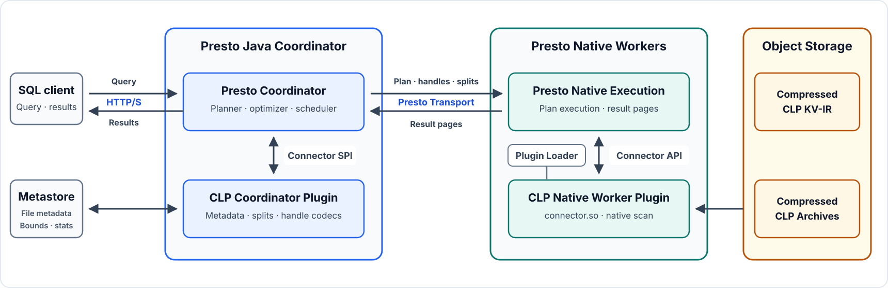

# The Pluggable CLP Connector for Presto Native: Specialized Storage for Semi-Structured Data

## Introduction

A data lake stores files in inexpensive object storage. A **lakehouse** adds a table layer, such as Apache Iceberg, so query engines such as Presto can read those files as SQL tables. This lets multiple engines share data, but it leaves a choice: how should that data be organized inside the files?

That choice matters for semi-structured data such as logs. A record’s **schema**—its field names and types—can vary: an error might be a number in one record, a message in another, and a nested object in a third. These variations make efficient storage and search harder.

**Columnar storage** groups values from the same field together, allowing queries to read relevant columns and compress similar values efficiently. Parquet’s Variant type accommodates changing record structures, but only selected fields and types get this columnar treatment. CLP (Compressed Log Processor) takes a different approach: it groups records by schema to keep every record in typed columns, with additional encodings for compressing and searching recurring text.

The next step is to query this storage layout through SQL. **Presto is the query engine**: it plans queries and distributes work across machines. The CLP **connector** lets that engine read CLP’s columns and use its compressed-search capabilities.

We worked with the Presto community to make this connector independently loadable in Presto Native, which executes queries in C++ workers. It now ships as a separate plugin package, replacing an integration that required maintaining modified engine code.

CLP is the first connector to use this architecture end to end; the required changes shipped in Presto 0.299. At Uber, this architecture stores about a petabyte of semi-structured data per day in CLP at roughly 30:1 compression, with thousands of Presto queries daily.

We first compare how Variant and CLP organize and search the same records, then explain file selection, deployment, and the plugin design. A shared SQL interface can support storage formats specialized for different workloads.

## Variant in the Lakehouse Landscape

Variant lets one SQL column hold values with different structures and types. Consider a `logs` table whose Variant column, `event`, contains these three records:

```jsonl
{"timestamp": "2026-10-19T12:00:00Z", "error": 504}
{"timestamp": "2026-10-19T12:00:00Z", "error": "connection timed out"}
{"timestamp": "2026-10-19T12:00:00Z", "error": {"code": 504, "message": "gateway timeout"}}
```

Three layers make these records queryable:

1. **Query-engine layer.** The engine provides operations to access Variant fields. In Databricks SQL, `:` accesses a field:

   ```sql
   SELECT event:error AS error FROM logs;
   ```

   SQL engines generally need to know each output column’s type before execution. Here, that type is Variant: each result preserves its integer, string, or object value. Without a type that accommodates this variation, the query would need conversion to a common type or produce a type error.

2. **Table layer.** Iceberg tracks the table’s schema and files. [Iceberg v3](https://iceberg.apache.org/spec/#semi-structured-types) lets the schema declare `event` as Variant without listing its internal fields. Those fields can change without changing the declared table schema.

3. **File-format layer.** Parquet typically stores the data. Its [binary Variant representation](https://parquet.apache.org/docs/file-format/types/variantencoding/) encodes each record’s structure, types, and values, alongside a dictionary of field names.

Together, these layers support dynamic records through a declared table schema. Binary Variant avoids parsing JSON text at query time, but extracting a field across many records can still be slow: the reader must navigate every relevant record’s binary value.

[Shredding](https://parquet.apache.org/docs/file-format/types/variantshredding/) addresses this bottleneck by extracting selected fields into typed Parquet columns. Queries can then read those columns directly, skip irrelevant data using column statistics, and benefit from columnar compression.

Each field has only one shredded type per file. Shredding `error` as an integer puts `504` in a typed column; the string and object stay in the row-based binary fallback. Returning all three requires both representations, preserving their original types.

The Parquet writer selects fields and types through [configuration or inference from sampled data](https://parquet.apache.org/blog/2026/02/27/variant-type-in-apache-parquet-for-semi-structured-data/). Changing those selections for an existing file requires rewriting it. The remaining challenge is to keep every record columnar as fields and types change.

## CLP: Native Columnar Semi-Structured File-Format

CLP addresses that challenge by discovering record schemas as data arrives. Within each compressed archive, it groups records with matching field paths and types into **Encoded Record Tables (ERTs)**. The three records above form three groups:

| Record schema shape | Columns in its ERT |
|---|---|
| Numeric error code | `timestamp`, `error` (integer) |
| Text error message | `timestamp`, `error` (string) |
| Structured error | `timestamp`, `error.code` (integer), `error.message` (string) |

A field path such as `error.code` identifies a field inside a nested object. Each ERT is an internal table containing only records with that schema; its columns therefore cover a subset of the archive’s records. New schema shapes form new ERTs. This keeps every record in typed columns without creating one wide table spanning every observed field.

An archive’s **Merged Schema Tree (MST)** acts as a map from field paths and types to these columns. The reader can locate `error`’s integer and string columns, or the column for `error.code`, before reading record values. The **metastore**, which tracks files belonging to each SQL table, does not track these record schemas; they live inside the archives.

CLP also separates recurring string values into **string shapes (templates)** and variables. For example, `request 123 timed out` and `request 456 timed out` share the illustrative template `request <request_count> timed out`, with `123` and `456` in a separate variable column. Storing repeated text once improves compression. Dictionaries of templates and repeated variable values also help narrow pattern searches before reading message values.

Meta’s [Nimble](https://github.com/facebookincubator/nimble), an alternative to Parquet and ORC, offers a related idea: [nested data streams](https://velox-lib.io/blog/nimble-stream-slicing/#nested-stream-mapping) need not have the same element count as the table’s row count. Nimble emphasizes wide datasets, extensible encodings, and parallel processing. CLP’s grouping, schema metadata, and text encodings are optimized for compression and search over dynamic records, as detailed in the [μSlope paper](https://www.usenix.org/conference/osdi24/presentation/wang-rui).

## From Predicate to Physical Scan: Parquet Variant and CLP

A **predicate** is a condition such as `error = 504`; a **scan** reads the stored data needed to evaluate it. The format determines which columns or binary values the reader must examine.

Log analysis is a common use case for semi-structured data. For example, troubleshooting a failure may start with an error code or message pattern, before the field path is known. The code might appear at `error.code`, `response.error.code`, or `upstream.error.code`. Wildcard-path matching searches across these locations. Support depends on the query engine; the file format determines what it must read. The table compares that work for engines implementing these searches:

| Search condition | Parquet Variant | CLP |
|---|---|---|
| `error` is the integer `504` | Read its integer column if shredded; otherwise inspect binary values. | Automatically use the schema map to locate and scan matching integer columns. |
| Integer `504` at a path matching `*.error.*` | Scan matching shredded integer columns. For unshredded data, read field names from Variant metadata and traverse each relevant record’s binary structure to match paths and integer types; then retrieve those integer values and compare them with `504`. | Automatically find integer columns whose paths match `*.error.*` in the schema map, then scan only those columns for `504`. |
| Messages matching `request … timed out` | Apply wildcard or regex matching to string values (or whole-string dictionary entries when supported). Variant neither stores nor exposes string templates. | Match string shapes in the dictionary, then scan the integer ID column for matching shape IDs; check variable values when needed. |

For a known, shredded field, both formats can scan typed columns. CLP makes columnar access available across observed paths and types, while string shapes help narrow text searches. These advantages matter when schemas change, field locations are unknown, and messages repeat; stable schemas and mostly unique text offer less benefit.

The connector currently supports cross-field value search. Broader wildcard key/path support is being prepared for open-source release; the table describes the archive format’s capability.

The connector brings these scan capabilities into Presto. Archive metadata narrows the work inside each file; next, we look at how the metastore reduces the number of files to read.

## Beyond File Pruning: Leveraging Metastore and CLP Metadata

Queries can be narrowed in three stages. First, ordinary metastore pruning removes files that cannot match. Second, Uber's latest-`N` planning can stop selecting older files that may contain matches but cannot change the result. Third, once a CLP archive becomes a split, its archive-local metadata narrows the columns and encoded streams to read.

The native connector can scan two CLP storage forms when its split provider supplies them: compressed key-value intermediate representation (KV-IR) files, which are appendable, streamable, and searchable, and compact immutable archives. Both can be searched through streaming reads, while KV-IR can continue growing. Uber's internal metastore plans across both forms and applies the first two stages across billions of file records.

Presto represents `ORDER BY ... LIMIT` with a distributed Top-N. In the conventional Hive-style path, Top-N limits the result, not the scan: it sits above split discovery and cannot tell the split source when enough data has been found. Every file that survives ordinary pruning remains eligible because an unseen file may still contain a newer qualifying row. At log scale, a small `LIMIT` can therefore still require a large scan.

At Uber, the metastore can stop enumerating files early for eligible Top-N queries without changing the result. This differs from pruning: pruning asks whether a particular file can match, whereas the Top-N optimization asks whether any remaining older file could change the latest `N` results. A skipped file may contain matches, but none recent enough to enter the result.

After ordinary pruning, Uber's metastore receives candidate files ordered by maximum timestamp, newest first. For filters such as application or host, it can use exact per-file matching-event counts when the metadata provides them. Once the cumulative count reaches `N`, the lowest event-time bound among the files considered so far becomes a **watermark**. The metastore keeps every file whose event-time range overlaps that watermark and stops only when the next file's maximum timestamp falls below it. Because the candidates are ordered, the metastore can stop reading older metadata and creating splits. Workers never open those older files.

If any row-level filter prevents an exact per-file matching count, Uber keeps every file that remains after normal pruning. This optimization depends on accurate file time bounds and matching-event counts. Append-only, time-ordered files keep those bounds stable and often reduce overlap, making the optimization more effective, but those properties alone do not make the cutoff correct. This is an Uber production extension and is not available in the current open-source connector.

After a file becomes a split, ordinary column statistics and indexes can still narrow its scan. A CLP archive begins with compact metadata, including the archive-local MST and dictionaries for log templates and values. The MST provides the complete path/type-to-column map, while log-template metadata captures structure inside text values. A worker reads this metadata first, identifies candidate columns, and streams the relevant encoded data without staging the complete archive locally. The metastore chooses the files. CLP metadata narrows the work inside each archive.

Across Uber's current mix of CLP workloads, the enriched log records achieve a roughly 30× raw-to-compressed ratio. Those records include high-cardinality identifiers such as trace IDs, which contain little repetition and compress poorly. A handful of Presto Native workers query the resulting CLP data directly from object storage. These figures describe Uber's production deployment, not a controlled benchmark against Parquet Variant or another format. To Presto, this still appears as an ordinary catalog: the metadata provider selects files, and CLP narrows each selected archive.

## Deploying and Querying with the CLP Connector

Presto users query CLP through ordinary SQL while the connector preserves its storage-native scan. A single query can combine exact typed paths, cross-field search, and whole-event reconstruction:

~~~sql
SHOW TABLES FROM clp.default;

SELECT
    CLP_GET_STRING('service.name') AS service,
    CLP_GET_BIGINT('response.status') AS status,
    CLP_GET_JSON_STRING() AS event
FROM clp.default.application_logs
WHERE CLP_GET_BIGINT('response.status') >= 500
  AND CLP_WILDCARD_STRING_COLUMN() LIKE 'timeout%'
LIMIT 100;
~~~

Replace `application_logs` and the paths with a deployed dataset. Typed accessors make the expected value type explicit. `CLP_WILDCARD_STRING_COLUMN()` searches string values across compatible fields without naming a field. Despite its name, it performs cross-field value search rather than the broader arbitrary wildcard key/path matching shown in the comparison table. The whole event is reconstructed as JSON only for projected matches. An optional Presto table schema, called a **convenience schema**, can expose frequently used paths as ordinary typed columns.

Future PrestoDB Variant support could give CLP paths more natural SQL access without replacing CLP's physical storage model. YScope's [August 2025 walkthrough](https://blog.yscope.com/querying-clp-compressed-logs-with-prestosql-71dff29a0b82) covers the existing rewriting and pushdown mechanics.

For an operator, the deployment path is short: ingest with CLP and install the version-matched Java coordinator plugin and native worker bundle. On the coordinator, enable `use-connector-provided-serialization-codecs`. On each worker, point `plugin.dir` to the native bundle. Install matching `etc/catalog/clp.properties` files on the coordinator and workers.

The [documented setup](https://docs.yscope.com/presto/connector/clp.html) uses the MySQL-backed metadata provider populated by YScope's open-source CLP package. Metadata and split discovery sit behind provider interfaces. A deployment can implement and wire those interfaces for another metastore without changing the native scan. The connector is read-only and exposes discovered datasets in its `default` schema. Its [packaging flow](https://github.com/y-scope/clp-plugin-presto-connector/blob/main/tools/build-packages/README.md) supports OS packages, tarballs, and an init-container image.

Two Docker Compose configurations illustrate the setup. The connector's [coordinator-and-native-worker stack](https://github.com/y-scope/clp-plugin-presto-connector/blob/main/integration-tests/docker-compose.yaml) installs version-matched artifacts through the shipped installer image. The CLP [deployment stack](https://github.com/y-scope/clp/blob/main/tools/deployment/presto-clp/docker-compose.yaml) places the coordinator and worker in a complete CLP environment.

Behind this deployment is a contract between the Java coordinator plugin and the native worker plugin.

## Building Pluggable Presto Native Connectors: Lessons from CLP

[Presto Native](https://prestodb.io/docs/current/presto-cpp.html), Presto's C++ worker implementation, executes connector scans in Velox-based workers. An out-of-band connector therefore needs a Java coordinator half and a dynamically loaded native worker half. YScope engineers collaborated with the Presto community to build CLP as the first end-to-end plugin across that boundary.

The earlier integration already ran CLP natively, but it entered at the Velox execution layer and lived directly in the Presto Native and Velox source trees. Because those changes were not upstream, the deployment used a fork. It was an in-tree integration, not an external plugin. The native half of the current connector instead integrates with Presto Native at the worker-plugin boundary: a separate shared library built against Presto and Velox headers and loaded out of band. Native execution moved out of the fork, not out of the worker.

At this boundary, the Java plugin supplies table metadata, splits, and connector-specific handles to the Presto coordinator. Presto serializes those handles into the plan it schedules on native workers. On each worker, the connector adapter decodes the handles and the dynamically loaded plugin performs the storage-specific scan. Presto carries this information across the boundary, so the connector does not need its own Java-to-native RPC. When the split provider supplies both storage forms, a query can span compressed KV-IR files and immutable archives without forcing every observed path and type into one global Presto table schema:



Three lessons from CLP apply to other external Presto Native connectors.

**Define the coordinator–worker contract.** Begin by listing every connector-specific object that crosses the boundary. For CLP, these are table, table-layout, column, split, and transaction handles, along with pushed-down operations and filters left for Presto to evaluate. This inventory determines the Java codecs, native handle adapters, and data-source interfaces the connector must implement.

CLP's [`ClpPlugin`](https://github.com/y-scope/clp-plugin-presto-connector/blob/main/presto-connector/src/main/java/com/facebook/presto/plugin/clp/ClpPlugin.java) and [`ConnectorCodecProvider`](https://github.com/y-scope/clp-plugin-presto-connector/blob/main/presto-connector/src/main/java/com/facebook/presto/plugin/clp/codec/ClpConnectorCodecProvider.java) show the Java side of this contract. On the native side, [`registerExtensions`](https://github.com/y-scope/clp-plugin-presto-connector/blob/main/velox-connector/src/ClpPluginEntry.cpp) registers the connector factory and handle adapter. A linker version script exposes only that entry point, and `plugin.dir` points the worker to the packaged library.

Two Presto hooks support this contract. [PR #27653](https://github.com/prestodb/presto/pull/27653) allows the worker loader to register a connector factory from dynamically loaded code. On the coordinator, `use-connector-provided-serialization-codecs` selects the connector's handle codecs. [PR #27652](https://github.com/prestodb/presto/pull/27652) routes those serialized handles to the corresponding native adapter. Execution remains inside the worker process, avoiding a sidecar service or a per-record language boundary.

**Package one compatible unit.** CLP builds on `manylinux_2_28` for `amd64` and `arm64`, stages the coordinator JAR and worker `.so`, puts native dependencies under `lib/`, and sets RUNPATH to `$ORIGIN/lib`. The same payload can be delivered as OS packages, a tarball, or an init-container image. The bundle must match libc, Presto Native, Velox, and CPU flags. Folly's `F14LinkCheck` verifies CPU-intrinsics mode across `dlopen`, so the [CLP build](https://github.com/y-scope/clp-plugin-presto-connector/blob/main/velox-connector/cmake/DeriveTargetCpuFlags.cmake) reuses Velox's `get_cxx_flags` helper.

**Test the deployed boundary.** Java unit tests cover predicate conversion, plan rewriting, metadata and split listing, and codec round trips. Native helpers that do not depend on Presto or Velox runtime symbols can be tested separately. The plugin deliberately leaves worker-owned symbols for the host process to resolve, so registration, deserialization, data sources, and vectors are exercised through a real worker. In CLP's [integration-test stack](https://github.com/y-scope/clp-plugin-presto-connector/blob/main/integration-tests/README.md), `task integration-tests:run` installs both artifacts and runs SQL through a Java coordinator and native worker against archive and KV-IR fixtures.

For an external connector, these pieces form one release unit: the tested coordinator artifact, native bundle, and serialized protocol.

## Conclusion: Choosing Semi-Structured Storage for Presto

Choose the lakehouse Variant stack when cross-engine portability and standard table semantics matter most. Shredding is most effective when writers can identify important paths before writing. Choose CLP when the analytical platform cannot control upstream schemas or content, recurring structure and text can improve compression and search, or queries must span fields not known at ingestion. Stable schemas and nearly unique shapes reduce CLP's advantages.

Future PrestoDB Variant operators could give CLP a standard dynamic SQL interface without replacing its ERT- and log-template-based execution. A common SQL interface need not imply a common physical layout. Through pluggable native connectors, Presto can own planning and distributed execution while storage engines preserve the encodings, metadata, and scan paths built for their workloads.

## Acknowledgments

At YScope, Jack Luo, Kirk Rodrigues, Rui Wang, Xiaochong Wei, and Chenxing Yang worked together to implement the connector. From IBM and the Presto community, Pratik Joseph Dabre, Matt Graham, Deepak Majeti, and Tim Meehan contributed infrastructure and review. At Uber, Karthik Bhat, Qingqin Hou, Maksym Ivanchenko, and Yun Zhang from the Observability team worked with YScope engineers to extend and apply the architecture in production. Curt Hu and Jianjian Xie from Uber's Presto team supported the Presto integration. Jianjian also supported the connector's deployment and ongoing maintenance at Uber. Special thanks to everyone who helped turn dynamic loading and connector-specific serialization into reusable Presto Native infrastructure.
