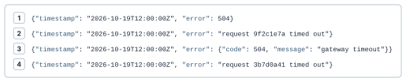
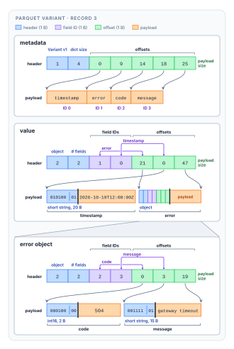
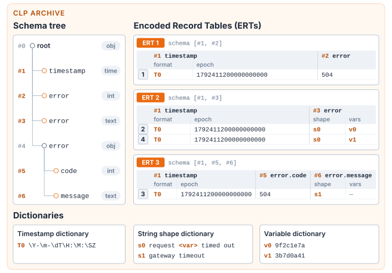
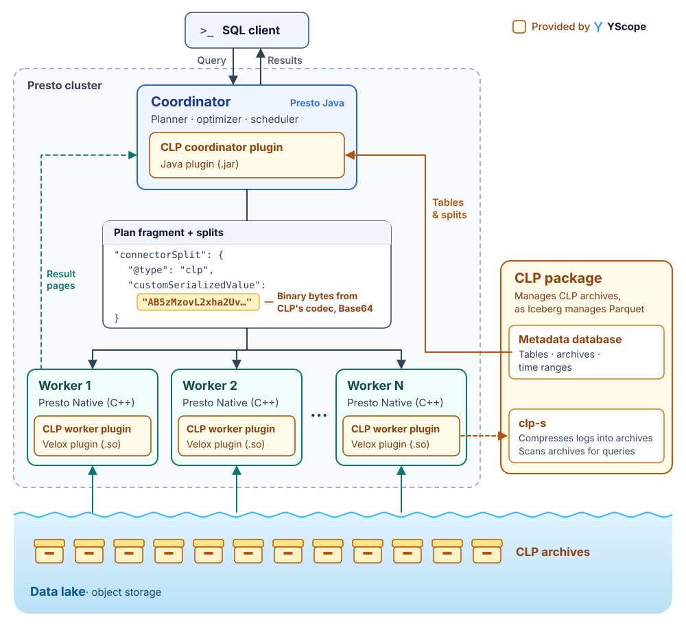

# One Lakehouse, Many Layouts: Plugging CLP into Presto

We describe how [CLP](https://github.com/y-scope/clp) brings efficient analytics to semi-structured data stored in the data lake, as part of a lakehouse solution provided by YScope. CLP automatically discovers schemas at ingestion, keeps every field queryable through columnar scans, and compresses data more than twice as well as Parquet. We also present a new plugin architecture for Presto connectors, which we have deployed at Uber to query a growing archive of logs ingested at a petabyte per day, with just five Presto workers.

## Introduction

For decades, data had to earn its way into a centralized warehouse: it had to be fitted to a schema designed in advance and locked in a proprietary format, leaving it queryable only by the warehouse's dedicated engine. As data exploded in volume and variety, such cost and rigidity of the warehouses could not scale accordingly. Enterprises began pouring data into cheap data lakes instead, where raw data lands in open formats such as Parquet. However, a lake alone only stores the data; it offers no data management for analytics. To fill this gap, the lakehouse architecture was defined: it adds a metadata abstraction such as Apache Iceberg on top of the data lake to organize the Parquet files into tables, such that query engines like Presto can query those tables directly, as they would a warehouse.

The lakehouse's promise is one copy of data that any engine can read and write, and this promise has proven increasingly valuable. On the same Parquet files, users can run SQL queries for BI or load the files as Arrow tables into ML frameworks such as Ray for model training. What the lakehouse leaves open is whether the physical layout beneath those tables should be unified as well. Our answer is no: a common table interface does not require a common physical layout, and a query engine can read each kind of data in the layout that fits it.

Take semi-structured data, such as JSON, as an example. Each semi-structured record can carry its own schema: a field present in one record may be missing from another, or hold a value of a different type. Such data, mostly logs, metrics, and traces produced for observability, often makes up a large share of what lands in a data lake. At Uber, roughly a PB of semi-structured data is produced every single day.

The common answer to semi-structured data in the lakehouse is the Parquet Variant type, whose fields are not known in advance. A Variant column stores each semi-structured record as binary, encoded with field names, types, and values. Reading one field therefore requires looking it up in every row's binary value, so the access is effectively row-wise, unless the field has been shredded, i.e., extracted into its own typed Parquet column. However, shredding requires selecting those fields through configuration or inference before the Parquet file is written, and this configuration tends to be conservative, so only the popular fields of semi-structured data are shredded and many cold fields remain row-wise.

We propose [CLP](https://github.com/y-scope/clp) as a first-class format for semi-structured data in the data lake because it stores logs' evolving fields in columnar format without selecting fields and types for shredding. CLP does so by discovering each record's structure at ingestion and grouping records that share a schema into tables for columnar lookup. Like Parquet, CLP is an open format, but it takes much less space in object storage. CLP achieves a compression ratio 2.31x higher on average than the best Parquet configuration evaluated in [YScope's Log Archival Bench](https://blog.yscope.com/log-archival-bench-a-framework-for-comparing-log-archival-analytics-tools-160e98b9d189), while supporting search without full decompression. For full lakehouse support, YScope's [CLP package](https://github.com/y-scope/clp) organizes CLP archives into tables, as Iceberg does for Parquet files, and we have built a Presto CLP connector that lets Presto query those tables. [YScope's August 2025 blog](https://blog.yscope.com/querying-clp-compressed-logs-with-prestosql-71dff29a0b82) describes the connector in detail.

Making CLP accessible to Presto is only the first step. We also wanted it to be easy to deploy in production. The [Presto CLP connector](https://github.com/y-scope/clp-plugin-presto-connector) is the first connector loaded as a plugin at runtime by both Presto's Java coordinator and Presto Native, its C++ execution engine. Traditionally, Presto Native required connectors to be compiled into its source tree, as with Presto's Iceberg connector. However, an in-tree connector is a long-term investment: Iceberg's has taken almost three years and roughly 300 commits, and is still growing. We raised this with the Presto community, and together we designed a plugin architecture: the connector ships as a separate artifact, and Presto loads it at runtime from a configured plugin directory. The required changes to PrestoDB shipped in Presto 0.299 so that any connector may reuse them.

This architecture is already deployed in production at Uber, where a petabyte a day of semi-structured data is stored in CLP at about 30:1 compression and queried through Presto with thousands of SQL queries per day. The rest of this blog compares Parquet Variant and CLP, explains the technical details of the plugin, and describes how Uber adopted CLP in its lakehouse architecture.

## Row-Wise Access in Parquet Variant for Semi-Structured Data, and Why Shredding Falls Short

Lakehouses support semi-structured data through Variant; however, the underlying file format, such as Parquet, can hold back Variant's performance because it makes field access row-wise. Variant is a SQL type that can hold an integer, a string, or an object in the same column. To make Variant accessible in a lakehouse, the support must encompass three layers: a query engine such as Presto, a table format such as Iceberg, and a file format such as Parquet.



*Figure 1: Four JSON records whose `error` field can hold an integer, a string, or an object.*

Consider the four JSON records in Figure 1. In a lakehouse table, they are stored as four rows of a single Variant column.



*Figure 2: Record 3 from Figure 1 encoded as a Parquet Variant, in two parts, `metadata` and `value`. `metadata` is the record's dictionary of field names. Its header (blue) holds the version and the number of names. Its offsets (green) mark where each name starts in the payload (orange), and a last offset gives the payload size. The position of the field name in the payload is treated as its ID. For instance, the `error` field's ID is 1 because it is positioned at index 1 in the payload. `value` holds a Variant value, whose layout depends on its type. An object's header (blue) holds the type and the number of fields. Its field IDs (purple) are sorted by the names of the fields, and each is linked to a matching offset (green) that marks where that field's value starts in the payload; a last offset gives the payload size. Its payload (orange) holds the field values consecutively, each itself a Variant value. A scalar is a one-byte header (blue) followed by its payload (orange). The header, drawn in binary, gives the type in its low 2 bits and, in its high 6 bits, either a short string's length or a primitive's type, which fixes the payload length.*

The table's underlying file format is often Parquet. Figure 2 shows how Parquet stores a Variant, which makes field access row-wise. Consider reading `error.code` from record 3:

1. Read the header of `value`, which says the record is an object with two fields.
2. Search the object's field IDs for `error`. The IDs are sorted by field name, so the reader binary-searches them, resolving each probed ID to its name through `metadata`. `error` is ID 1, in the first slot.
3. Read the offset in the same slot, 21, and jump to that position in the payload, where `error`'s value starts.
4. Read `error`'s header, which says it is another object, and repeat steps 2 and 3 for `code`: ID 2, in the first slot, with offset 0.
5. Read `code`'s header, which says it is a 2-byte integer, and decode the next two bytes: 504.

None of these steps carries over to the next record. Each record has its own dictionary and offsets, so the Parquet reader must repeat the same steps record by record. Therefore, accessing a field in a Variant column is row-wise and thus slow.

Shredding addresses this limitation by extracting selected Variant fields into typed Parquet columns, enabling columnar scans, compression, and data skipping. But **shredding a field does not necessarily make all its values columnar**. The Parquet writer selects fields and types through [configuration or inference](https://parquet.apache.org/blog/2026/02/27/variant-type-in-apache-parquet-for-semi-structured-data/), and each field can only have one shredded type per file. Shredding `error` as an integer puts `504` in a typed column, but leaves its string and object values in binary form. Queries accessing those values still require per-record navigation, and reading the complete field requires both representations.

Columnar coverage therefore depends on how well the selected shredding schema covers the data. As records introduce fields and types outside that schema, those values remain in the binary representation. CLP takes a fundamentally different approach by grouping records according to their observed schemas.

## CLP: Schema-Free Ingestion, Columnar Storage, and High Compression

Compared with storing semi-structured data in Parquet, CLP offers three advantages:

- **Schema-less ingestion.** CLP discovers every field and its type as data is ingested without requiring the schema in advance or selecting fields as Variant shredding does.
- **Columnar storage and search.** Every field, popular or rare, is stored as a typed column. A search scans only the columns it needs, directly from the encoded data.
- **High compression.** A high compression ratio directly translates to lower storage cost in the data lake. CLP is a state-of-the-art compressor for semi-structured data, averaging 68.1:1, so a petabyte shrinks to about 15 TB. In [YScope's Log Archival Bench](https://blog.yscope.com/log-archival-bench-a-framework-for-comparing-log-archival-analytics-tools-160e98b9d189), its compression ratio is 2.31× that of the best Parquet configuration evaluated.

Below, we use Figure 3 to explain at a high level how CLP achieves these advantages. For more details, please see our [OSDI '24 paper](https://www.usenix.org/conference/osdi24/presentation/wang-rui).



*Figure 3: The four records from Figure 1 stored in a CLP archive, where the schema tree, the ERTs, and the dictionaries provide schema-less ingestion, columnar storage, and high compression, respectively.*

CLP handles dynamic schemas with a schema tree, which is built incrementally at ingestion without any prior configuration. Each new key and type becomes a node with an ID. For example, the `error` field can be an integer, a string, or an object across these records, so it gets three distinct nodes: #2, #3, and #4.

CLP makes every field columnar by grouping records with identical schemas. A record's schema is the list of its leaf node IDs, e.g., [#1, #2] for record 1. Records with the same schema are stored together in one columnar **Encoded Record Table (ERT)**, with one typed column per leaf node; the four records thus land in three ERTs. A search on `error.code`, for example, scans only that column of ERT 3 and skips ERTs 1 and 2 entirely.

CLP compresses well because it understands what semi-structured logs are made of and encodes the recurring part of free text separately from its varying parts. The recurring part, called a string shape, goes to the string shape dictionary, and the varying parts, i.e., variables such as request IDs, go to the variable dictionary. For example, records 2 and 4 share the shape `request <var> timed out` (`s0`) and differ only in their request IDs (`v0` and `v1`), so their shape column holds only the encoded `s0`, and their variable column holds varying `v0` and `v1`. No matter how many requests time out, the shape is stored once, and each record keeps only a shape ID rather than the full message text.

The schema tree, the ERTs, and these dictionaries are bundled into an **archive**, CLP's basic storage unit, which serves as the ideal file format for semi-structured data in the lakehouse. Leveraging the archives' metadata, YScope's CLP package provides a table format tailored to CLP: it records the metadata CLP produces at compression, so a query can skip irrelevant archives before opening them. Finally, our Presto CLP connector must reconcile Presto's fixed schema with CLP's dynamic one. To that end, the connector exposes CLP's dynamic fields through UDFs, without defining any schema in advance. We also chose UDFs because Presto does not yet have a Variant type: its Iceberg connector [reads](https://prestodb.io/docs/current/connector/iceberg.html#type-mapping) an Iceberg Variant column as `JSON`. Once Presto supports Variant, we plan to migrate the connector's interface to it. For more details, see [YScope's Presto blog](https://blog.yscope.com/querying-clp-compressed-logs-with-prestosql-71dff29a0b82).

## From Predicate to Physical Scan: Parquet Variant vs. CLP

The cost of the same query can differ greatly depending on how the data is stored. Consider log analysis, a common use case for semi-structured data. Troubleshooting a failure often starts by matching an error code, e.g., `error = 504`, or a message pattern, e.g., `request … timed out`. Sometimes the search can be even vaguer: an engineer may not know which field holds the code, since it might appear at `error.code` in one service's logs and at `response.error.code` in another's. The table below compares what each format's reader must examine for each of these searches:

| Predicate | Parquet Variant | CLP |
| --- | --- | --- |
| `error = 504` | Row-wise unless `error` is shredded as an integer: look up `error` in each record's binary value, then compare it with `504`. | Strictly columnar: locate the ERTs with integer columns of `error` in the schema tree, then scan only those columns for `504`, skipping every ERT without integer `error`. |
| `message LIKE 'request % timed out'` | Row-wise unless `message` is shredded: look up `message` in each record's binary value, then match the pattern against it. Even if shredded, Parquet's dictionary holds whole strings, so the pattern still needs to be **matched against every distinct message**, e.g., `request 9f2c1e7a timed out`, `request 3b7d0a41 timed out`, and so on. | Strictly columnar: locate the ERTs with `message` columns in the schema tree, match the pattern **only once** against the string shape dictionary, e.g., `request <var> timed out`, then scan only those columns for the matching shape ID. |
| `*.error.* = 504` | Columnar and row-wise: locate the shredded columns whose paths match `*.error.*` and scan them for `504`, then traverse every record's binary value, since unshredded data may hold other matching paths. | Strictly columnar: resolve the ERTs that have columns matching `*.error.*` in the schema tree, then scan only those columns for `504`. |

In summary, the gap comes from how natively each format supports semi-structured data. Parquet is columnar, but within a Variant column only the shredded fields are; the rest are read row-wise. CLP stores every observed field as a typed column, so not only do all the searches above stay columnar, but much irrelevant data is also filtered out by the archives' metadata and the ERTs.

Parquet's limitations are well known, and CLP is not the only format designed to address them. Meta's [Nimble](https://github.com/facebookincubator/nimble), built as a replacement for Parquet, takes a related approach. Its [nested data streams](https://velox-lib.io/blog/nimble-stream-slicing/#nested-stream-mapping) need not have the same element count as the table's row count. However, Nimble targets a different workload. It is designed for wide datasets with thousands of columns, extensible encodings, and highly parallel hardware. Semi-structured data is not among its design goals.

## A Plugin Path for Presto Native Connectors

Like many other Presto connectors, the CLP connector has two halves. The Presto coordinator half reads tables, optimizes the query plan, and generates splits from the CLP package, and the Presto Native worker half retrieves the data from CLP archives.

The Presto coordinator was already able to load connectors as plugins through its Java SPI. The Presto Native worker, however, required the connector's source code at compile time because 1) it needed to create the C++ structs and parsing logic for each connector's handles defined in Java classes, i.e., the objects that describe a table, its columns, and each split, and 2) it registered connector factories statically. As a result, a new format such as CLP could reach Presto Native only as an in-tree connector inside the Presto and Velox source trees. This is the path Iceberg's native support took, with more than 300 commits in Presto Native and Velox.

We brought this problem to the Presto community. [RFC-0019](https://github.com/prestodb/rfcs/pull/49), proposed by Tim Meehan, describes the design that decouples the CLP worker connector from Presto Native. The worker loads connectors from shared libraries at startup, and the coordinator sends each plugin connector's handles as bytes that only the plugin can decode. We implemented the worker side and built CLP as the first connector to use this path end to end. The changes shipped in Presto 0.299.

Below, we first show how to add the CLP connector to an existing Presto cluster as a plugin, and then explain the protocol of how the two halves communicate.

### Configuring the Connector as a Plugin

The connector ships as two artifacts: a coordinator JAR and a worker shared library. Each goes into a plugin directory, and one coordinator setting switches handle serialization to the connector's own codecs:

```txt
# Coordinator: plugin/clp/clp-plugin-presto-connector.jar
# etc/config.properties
use-connector-provided-serialization-codecs=true

# Worker: <plugin.dir>/libclp-plugin-velox-connector.so
# etc/config.properties
plugin.dir=/opt/presto-server/plugin/clp
```

### How the Coordinator and Worker Communicate

On the coordinator, the CLP plugin plans the query as other connectors do. It resolves tables, optimizes the plan, e.g., by converting the pushed-down predicates into a domain-specific language, and lists the splits, i.e., the CLP files the query must scan. Presto then sends each plan fragment and its splits to the native workers as JSON.

With `use-connector-provided-serialization-codecs` enabled, the coordinator serializes each CLP handle, e.g., a split's file path and translated query, into bytes with CLP's own codec. In the resulting JSON, the handle is reduced to two fields. `@type` names the connector, here `clp`, and `customSerializedValue` holds those bytes, Base64-encoded.[^1] In contrast, an in-tree handle spells out every one of its fields in the JSON, and the worker can parse them only because matching C++ structs were compiled into Presto Native. On the worker, Presto Native reads `@type` and hands the bytes to the plugin registered under that name at startup, i.e., the CLP plugin. The CLP plugin decodes the bytes and scans the file inside the worker's own Velox pipeline.[^2] Figure 4 summarizes this path.



*Figure 4: The plugin architecture of the Presto CLP connector, together with the end-to-end flow of YScope's lakehouse solution for CLP. All components are open source and provided by YScope.*

## Uber Deployment

At Uber, semi-structured data is stored in CLP, while business data such as trips is stored in Parquet tables that Presto reads through its Hive connector. Because CLP is one more Presto catalog, a cluster configured with both catalogs can potentially join them in a single query. For example, to find which services returned errors for one day's failed trips in one city, an engineer can join the trip table with the services' logs:

```sql
SELECT
    CLP_GET_STRING('service') AS service,
    COUNT(*) AS errors
FROM hive.rides.trips AS t                    -- Parquet
JOIN clp.default.trip_service_logs AS l       -- CLP
    ON CLP_GET_STRING('trip_id') = t.trip_id
WHERE t.datestr = '2026-10-16'
  AND t.city_id = 1
  AND t.status = 'FAILED'
  AND CLP_GET_BIGINT('timestamp') >= 1792108800000   -- 2026-10-16, epoch ms
  AND CLP_GET_BIGINT('response.status_code') >= 500  -- HTTP 5xx: server errors
  AND CLP_GET_STRING('message') LIKE 'request % timed out'
GROUP BY 1
ORDER BY errors DESC;
```

Presto plans the two sides separately. The Hive connector reads `trips` from Parquet and prunes partitions by `datestr`. The CLP connector reads `trip_service_logs`, a table with no declared schema. `CLP_GET_STRING` and `CLP_GET_BIGINT` name each field by its JSON path and type, yet CLP still reads each field from its own column. All three predicates are pushed down to CLP, where each filters out irrelevant data by leveraging a different kind of metadata at a different granularity: `timestamp` is checked against each archive's time range, `response.status_code` filters out ERTs whose schema lacks that field, and `message` filters out string shapes that do not match the pattern. Presto then joins the two sides on `trip_id` and aggregates as usual. Neither table is copied or converted; each stays in the layout that fits it.

The CLP side of this deployment runs on five Presto worker nodes that read directly from object storage. It serves hundreds of weekly active users and thousands of queries per day, with a mean response time of roughly two seconds; 99% of queries complete within 26 seconds. These queries are not small: a query may span 30 days of logs, i.e., hundreds of gigabytes that a naive engine would scan in full.

Five nodes are enough because most of that data is never read. Across a 30-day production window, the connector cut the data examined by more than 200,000×. Three tiers of optimization make this possible, outlined briefly below:

- **Metastore pruning.** Ingestion records per-file metadata, such as time range and service, in a relational metastore. Predicates that match this metadata, e.g., the `timestamp` bound above, prune files before any of them is opened.
- **TopN early termination.** Many queries are investigative and ask only for the N most recent events. For these queries, the metastore's per-file event counts let the connector open only the newest files needed to reach N, plus any older file whose time range still overlaps theirs.
- **CLP-native pruning.** Within each opened CLP archive, CLP skips tables whose schema cannot match, e.g., tables without a `status_code` field, checks its dictionaries before scanning rows, and materializes only the matching rows into Velox vectors for vectorized execution.

## Conclusion

The lakehouse promises a unified interface to data, but that does not require a unified storage format. While Parquet excels at structured data, CLP is purpose-built for semi-structured data. By automatically discovering schemas at ingestion, storing every field in typed columns, and achieving more than twice Parquet's compression ratio, CLP enables more efficient storage and analytics without sacrificing the flexibility of the lakehouse architecture.

Our integration with Presto demonstrates two important advances. First, **CLP can complement Parquet in the same lakehouse**, allowing each type of data to use the storage format best suited to it while remaining accessible through SQL. Uber's production deployment shows this approach at scale, storing a petabyte of logs daily and serving thousands of queries a day with just five Presto workers.

Second, **Presto Native now supports out-of-tree connectors as runtime plugins**, eliminating the need to integrate new connectors into the Presto and Velox source trees. CLP is the first connector to use this architecture end to end, but the capability is available to the broader Presto community, making it easier to bring new storage formats and data sources into the Presto ecosystem.

---

[^1]: On the coordinator, [PR #26257](https://github.com/prestodb/presto/pull/26257) by Tim Meehan, released in Presto 0.296, lets a connector provide its own serialization codecs.

[^2]: On the worker, [PR #27652](https://github.com/prestodb/presto/pull/27652) routes the serialized bytes to the plugin, and [PR #27653](https://github.com/prestodb/presto/pull/27653) lets a shared library register a connector factory by loading plugins before the worker creates its catalogs. Both shipped in Presto 0.299.
