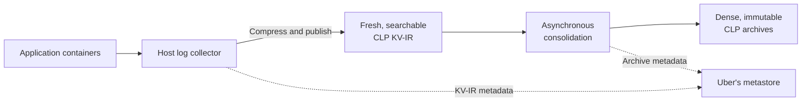
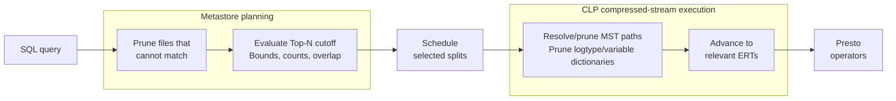

# Fresh Logs, Dense Archives, Native Semi-Structured Querying with Presto: CLP at Uber (Part III)

**Document status:** Working publication draft

At Uber, machine learning, AI, streaming, and data platform workloads using the [Compressed Log Processor (CLP) platform](https://github.com/y-scope/clp) produce approximately 25 PB of raw semi-structured logs each month. Built to compress and search evolving semi-structured data, CLP reduces that volume to 750–850 TB. Yet five 48-core [Presto Native](https://prestodb.io/docs/current/presto-cpp.html) workers—Presto's C++ worker implementation—query it directly from Uber's internal object storage, typically at 5–10% CPU utilization and without staging or caching complete archives. How can such a small query cluster provide SQL access at that scale?

This blog continues Uber's CLP series. The first blog, [“Reducing Logging Cost by Two Orders of Magnitude Using CLP”](https://www.uber.com/en-GB/blog/reducing-logging-cost-by-two-orders-of-magnitude-using-clp/), demonstrated compression and write-path savings for Spark logs. The second, [“Modernizing Logging at Uber with CLP (Part II)”](https://www.uber.com/gb/en/blog/modernizing-logging-with-clp-ii/), covered production ingestion, retention, and viewing. This third blog follows evolving semi-structured logs end to end: how Uber keeps fresh data searchable, consolidates it into dense CLP archives, and queries fresh and archived data natively with Presto.

Compression is only part of the answer. Across planning and execution, Presto, Uber's metastore, the connector, and CLP use different information to avoid unnecessary work when querying fresh KV-IR and archives.

## When Applications Define the Log Structure

Thousands of applications and platforms emit logs at Uber on independent release schedules, often with multiple versions running at once. As a result, log fields, nesting, and value types can change continuously. One event may be natural-language text with embedded variables. Another may be nested JSON. The same path may contain an integer, string, or object. The data is **semi-structured** because its fields are discoverable without one predefined schema, and **polymorphic** because one path can hold several value types.

The [second blog in the series](https://www.uber.com/gb/en/blog/modernizing-logging-with-clp-ii/) explains how Uber preserved existing messages while adding structured operational context. A record can now combine natural language, typed fields, and nested objects whose structure evolves independently. The [μSlope paper](https://www.usenix.org/conference/osdi24/presentation/wang-rui) from OSDI '24, by [YScope](https://yscope.com/), the University of Toronto, and Uber, explains how CLP stores such records.

Requiring one global table schema would turn routine application changes into coordinated migrations. Storing each event as an untyped JSON string avoids those migrations, but every query must parse the string and rediscover its fields and types. CLP takes a third approach: it records structure as events arrive without requiring one schema for the entire dataset.

## Fresh Logs: Searchable Before Archiving

CLP uses a two-phase approach so logs remain compressed and searchable before archive construction. First, collectors stream events into appendable, compressed [**key-value intermediate representation (KV-IR)**](https://docs.yscope.com/clp/main/dev-docs/design-kv-ir-streams/index.html) files that remain searchable while growing. Later, consolidation combines groups of closed KV-IR files into immutable, columnar archives for even better compression and faster search. Uber's metastore tracks both.

KV-IR extends the message representation introduced in the [first blog in this series](https://www.uber.com/en-GB/blog/reducing-logging-cost-by-two-orders-of-magnitude-using-clp/) to key-value events and carries their evolving structure in the same compressed stream. When an event introduces a new path or value type, KV-IR first writes the corresponding schema-tree update into the stream. Each event then references that streamed structure alongside its encoded values. CLP can therefore decode every readable part of the growing stream with a complete schema tree.

In the current deployment, a collector on every host performs CLP compression instead of each application's log appender. The collector monitors container logs, enriches events, and appends them to compressed KV-IR. Because the collector runs outside the application container, it can continue compressing and publishing logs the application emitted before the container exited.

As in the [second blog in this series](https://www.uber.com/gb/en/blog/modernizing-logging-with-clp-ii/), configurable timers tell the collector to upload the latest KV-IR data and metadata without closing the local stream. Once Uber's metastore processes an upload's metadata update, queries can find the new events while they remain in KV-IR—typically within 30 seconds to a few minutes of being emitted.

## Dense Archives: Asynchronous Columnar Consolidation

For longer retention, our aggregation service selects closed KV-IR files for consolidation. A worker then uses CLP to combine each selected group into an immutable archive. Consolidation runs asynchronously, and queries continue using KV-IR while the archive is built.

The worker builds the archive directly from encoded KV-IR. As it streams each input, CLP merges its schema tree into the archive's **Merged Schema Tree (MST)**, a map of every observed path and value type. Each event's schema identifies the **Encoded Record Table (ERT)** for its exact combination of paths and types, then CLP appends encoded values to its columns. You can think of the archive as compact internal tables, one per record shape. Because each shape has its own ERT, absent fields do not create null entries. CLP also separates recurring static text patterns, called **logtypes**, from typed variables in separate ERT columns.

When an archive combines similar log files, CLP can deduplicate more recurring structure, logtypes, and values across them. Grouping files queried together can also reduce the number of archives a query opens. Archive grouping must balance object size, request cost, query latency, and parallelism.



**Figure 1: Fresh KV-IR remains searchable while asynchronous consolidation creates denser archives. Uber's metastore tracks both.**

## Native Semi-Structured Querying with Presto

The second blog showed how engineers view individual compressed logs. At Uber, the same data must also support projection of evolving fields, aggregation of recurring patterns, and analysis across files and time ranges for on-call diagnosis, experimentation, and broader analytics. Engineers can use Lucene-style searches with pipe commands or write SQL directly. Uber normalizes and validates both forms before sending the resulting SQL to Presto, where existing access controls and tooling apply. Users don't need to know whether an event is in KV-IR or an archive.

The [open-source CLP connector](https://github.com/y-scope/clp-plugin-presto-connector) presents KV-IR and archives as one logical source. Each selected physical file becomes a **split** assigned to a Presto worker. A KV-IR split contains one logical log file, while an archive split may contain many. After consolidation, a logical file can remain in KV-IR until purged, even when already present in one or more archives. Uber's metastore selects one copy. An archive takes priority over KV-IR, and the latest archive wins when several contain the file. A query can therefore cover fresh and archived data without duplicate events.

Presto must know an expression's result type when planning a query. In CLP data, however, a path may be absent or hold different types across events. Lakehouse users may recognize this from [Variant](https://parquet.apache.org/docs/file-format/types/variantencoding/), whose values retain nested types, and optional Parquet [Variant shredding](https://parquet.apache.org/docs/file-format/types/variantshredding/), which materializes selected paths. The preceding **[PrestoDB blog](PRESTO_BLOG_URL)** compares Variant and shredding with CLP.

Until PrestoDB supports Variant end to end, the connector exposes common path-and-type pairs as table columns and accesses other paths through [typed functions](https://docs.yscope.com/presto/connector/clp.html). `CLP_WILDCARD_STRING_COLUMN()` searches strings without an exact field name, while `CLP_GET_JSON_STRING()` returns a complete event. Future Variant operators could replace the exact-path accessor syntax. CLP would still execute wildcard-key searches efficiently against its native storage. Queries can combine these forms:

```sql
SELECT
    timestamp,
    application_id,
    CLP_GET_STRING('event.request_id') AS request_id,
    CLP_GET_BIGINT('event.status_code') AS status_code
FROM clp.platform_logs
WHERE timestamp >= current_timestamp - INTERVAL '30' DAY
  AND application_id = 'example-application'
  AND CLP_GET_BIGINT('event.status_code') >= 500
  AND CLP_WILDCARD_STRING_COLUMN() LIKE 'OutOfMemory%'
ORDER BY timestamp DESC
LIMIT 100;
```

These user-defined functions (UDFs) do not materialize complete events before accessing fields. The connector passes the requested paths and predicates to CLP. [YScope's August 2025 blog](https://blog.yscope.com/querying-clp-compressed-logs-with-prestosql-71dff29a0b82) gives the full rewriting and pushdown walkthrough.

In production, each query passes through four stages:

1. **Analyze.** Identify metastore filters, work CLP can perform, and whether the query supports Top-N file skipping.
2. **Select.** Choose physical KV-IR files and archives, resolving overlapping logical-file coverage before creating splits.
3. **Scan.** Stream selected compressed files from object storage while CLP applies filters and projections.
4. **Finish.** Reconstruct matching results, then let Presto evaluate any expressions and operators not pushed into CLP.

## Exploiting Data Knowledge at Every Layer

Queries with selective filters run efficiently on five workers because three layers reduce how much data each query must process.

First, Uber's metastore tracks each file's location, format, event-time bounds, event counts, indexed fields and paths, and other statistics across billions of records. When a query's time, application, host, job, or correlation-ID filters cannot match a file's metadata, Presto does not create a split or read the object. This is file pruning. The open-source connector is agnostic to the metadata provider, so each deployment can plug in an implementation suited to its own catalog and storage system.

Second, most log queries ask only for the latest matching events:

```sql
ORDER BY timestamp DESC
LIMIT N
```

With Presto's normal distributed **Top-N** execution, workers process every scheduled candidate split before the engine can determine the `N` latest rows. At Uber, file selection uses event-time bounds and exact matching-event counts for supported metadata filters to determine when older files cannot change the latest `N` results. This happens before split creation, so Presto never schedules those files for workers to open. This is not ordinary pruning. A skipped file may contain matching events, but none can enter the latest `N` results.

For Top-N queries that meet these conditions, Uber's metastore returns files in descending order of their maximum timestamps. Once the matching-event counts for the files considered so far reach `N`, the metastore sets the earliest event timestamp covered by those files as a **watermark**. The metastore includes every file whose event-time range overlaps the watermark. It stops only when the next file's maximum timestamp is earlier than the watermark. If row-level filters prevent the metastore from knowing how many events match, it keeps every file that remains after normal pruning. This optimization depends on accurate event-time bounds and matching-event counts for every file. Append-only writes and time ordering make those values easier to update as a file grows. Tighter, less-overlapping time ranges also let the metastore skip more older files. These properties help, but do not by themselves make the optimization correct. Uber runs this file-skipping logic in production. It is not yet part of the open-source connector.

Finally, each archive begins with metadata that CLP reads before scanning the encoded event data. The MST maps paths and types to ERT columns. Indexed logtype and variable dictionaries describe recurring text and values. The connector uses the MST to find columns for exact paths or wildcard-key searches and rule out unrelated structures. CLP then uses its logtype and variable dictionaries to eliminate values that cannot match before advancing to the relevant ERTs and reconstructing results.



**Figure 2: Pruning removes files that cannot match. For eligible Top-N queries, a separate check uses time bounds, matching-event counts, and overlap handling to avoid scheduling unnecessary older files. Otherwise, Presto schedules every file remaining after pruning. CLP metadata then narrows each selected archive.**

Queries that cover many files and events can still take a long time. During planning, Uber detects these broad queries and suggests narrower time or metadata filters. That simple prompt often leads users to add constraints they already know, substantially reducing the scan. Users can still proceed when they need the complete result.

## Production Results

For workloads now using CLP, approximately 25 PB of raw logs per month becomes 750–850 TB: 29–33× compression and about 97% less storage. The [first blog in the series](https://www.uber.com/en-GB/blog/reducing-logging-cost-by-two-orders-of-magnitude-using-clp/) reported 169× for Spark messages alone. Today's 29–33× figure spans a broader set of workloads whose records are also enriched with operational fields such as hostnames, tags, and trace IDs (UUIDs). Values such as trace IDs are effectively unique and contain little repetition for a compressor to exploit.

Five 48-core Presto Native workers serve Uber's CLP SQL workload, reading KV-IR files and archives directly from object storage. They typically use only 5–10% of their CPU capacity. We also rate-limit object-storage reads to reduce parallelism and preserve bandwidth for other workloads. Queries still meet our latency needs, leaving room to serve more queries or onboard more workloads.

During **[MEASUREMENT_WINDOW]**, the service supported **[WEEKLY_ACTIVE_USERS] weekly active users** and **[DAILY_QUERY_VOLUME] daily queries**, with average end-to-end latency of **[AVG_LATENCY_SECONDS] seconds** and 99th-percentile (p99) latency of **[P99_LATENCY_SECONDS] seconds**. These measurements must describe one query population. Monthly ingest is not per-query scan volume.

> **Publication evidence required:** Add one representative timestamp-only versus richer-metadata pruning comparison, and plot users and query volume over an approved measurement window. Define the operational scope before making a maintenance-effort claim.

These production results reflect the full query path, not compression alone. They also motivate two areas for further development: using metadata to improve data placement and helping agents explore unfamiliar data without guessing paths or search terms.

## What Comes Next

### Smarter Data Placement and Consolidation

**Intelligent tiering.** CLP could be the default storage tier, with a hot index added only when demand justifies it. How often a table is queried, which fields and time ranges those queries access, and its retention requirements could determine whether it needs a hot index and how long data should remain there. CLP would retain the longer history while keeping it queryable. If query demand rises, the system could quickly restore selected tables or time ranges from CLP to the hot index.

**Grouping similar data during consolidation.** We could use CLP's stored structure and patterns, file sources, and query history to decide which closed KV-IR files belong in an archive. Grouping files with similar structure and recurring text creates more opportunities for cross-file deduplication. Putting frequently queried data together can also reduce archive opens. Time range, retention, freshness, and archive size would still constrain each group.

### Beyond Guesswork: Putting CLP Metadata to Work for Agents

More than half of current query traffic reaches the production SQL path through a [Model Context Protocol (MCP)](https://modelcontextprotocol.io/docs/getting-started/intro) server. That usage exposes two gaps. To write a precise query, an agent first needs to know which paths, types, and patterns exist. To explore the data directly, it needs to search by meaning and summarize matches without retrieving every raw event. Today, agents guess keywords and hope one surfaces relevant events. A narrow term may return nothing, while a broad one may return more events than the agent can use.

What excites us is that CLP could support both workflows without first reconstructing raw events. An agent could scope the search by time, application, or version. After applying those filters, the query service could place the paths, types, distinct logtypes, and their counts from the remaining data into the agent's context. Before writing the next query, the agent would know how the matching data is structured, which message patterns occur, and how often.

`PATTERN(path)` could return recurring text patterns and their frequencies without reconstructing every event. `SEMANTIC(path, description)` could find relevant patterns when the agent knows the concept but not its exact wording. A future `SUMMARY()` could turn the unique matched patterns and their counts into a concise explanation, with representative events and source links as evidence.

After receiving that context, an agent could generate a query like the following to find recurring [Claude Code](https://docs.anthropic.com/en/docs/claude-code/getting-started) tool-output patterns related to native connector loading failures:

```sql
SELECT
    PATTERN('message.content[*].content') AS failure_pattern,
    count(*) AS occurrences
FROM clp.claude_code_session_transcripts
WHERE CLP_GET_STRING('type') = 'user'
  AND SEMANTIC(
      'message.content[*].content',
      'tool output reporting a native connector load failure'
  )
GROUP BY PATTERN('message.content[*].content')
ORDER BY occurrences DESC;
```

In Claude Code transcripts, top-level `type` distinguishes user, assistant, and system records. Polymorphic `message.content` may hold text or typed blocks, including tool results. The query narrows the record type, matches tool-result meaning, and groups recurring patterns with their counts.

CLP could perform these operations over filtered paths, unique logtypes, dictionary values, and stored counts, then fetch individual events only when an agent needs examples or source evidence. These ideas still need refinement and evaluation.

## Open Source and Collaboration

The core query path is open source. [CLP](https://github.com/y-scope/clp) provides semi-structured compression and search, and the [CLP Presto connector](https://github.com/y-scope/clp-plugin-presto-connector) presents KV-IR and archives through one Presto interface. It supports typed paths, wildcard-key value searches, complete-event reconstruction, and filter and projection pushdown. Deployments can integrate their own metadata and split providers.

Uber's production deployment adds a metastore that manages billions of file records and performs Top-N file skipping. The query layer above it handles routing, reliability, and operational controls. This production foundation also gives us a practical starting point for the storage and agent improvements described above. We are still developing and evaluating those improvements.

YScope engineers led the connector implementation. IBM engineers and the Presto community supported the native connector infrastructure and review. YScope and Uber engineers then extended the connector architecture for Uber's production deployment. Presto handles SQL and distributed execution. Through the pluggable connector, CLP searches its compressed representation and reconstructs only the requested results.

## Conclusion

At 25 PB per month, efficient queries depend on avoiding unnecessary work at every layer. Uber's metastore reduces the files that Presto schedules. Within each selected file, CLP uses its encoded structure and metadata to avoid decompressing and reconstructing unrelated data. Presto queries fresh KV-IR and dense archives through one SQL path.

The broader lesson is that a common SQL engine does not require one physical storage model. Presto handles SQL and distributed execution, while CLP preserves and searches application-defined semi-structured data in compressed form. Together, they provide an Uber-wide query service with substantial capacity for more queries and workloads.

Finally, we want to put metastore and CLP archive metadata to further use: optimize data placement, help agents generate queries from observed structure and patterns, and support semantic search and evidence-backed summaries.
