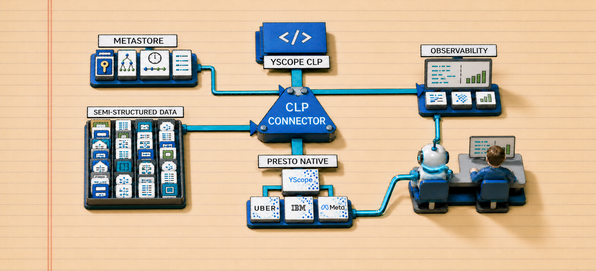
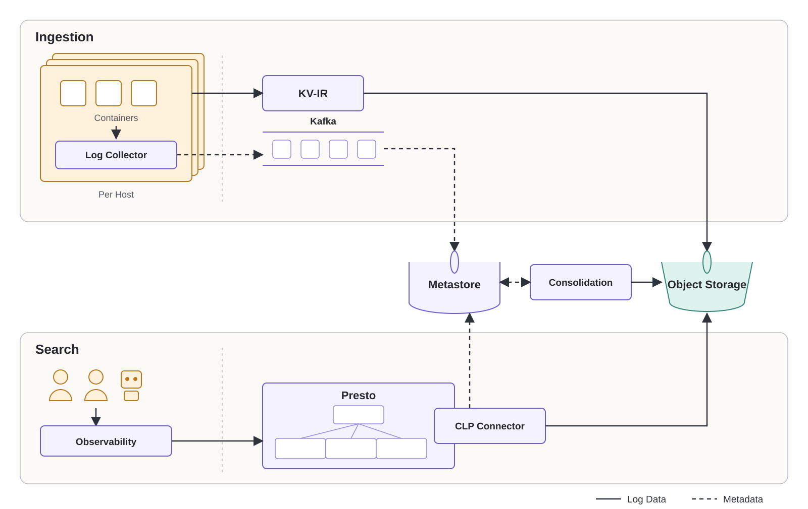
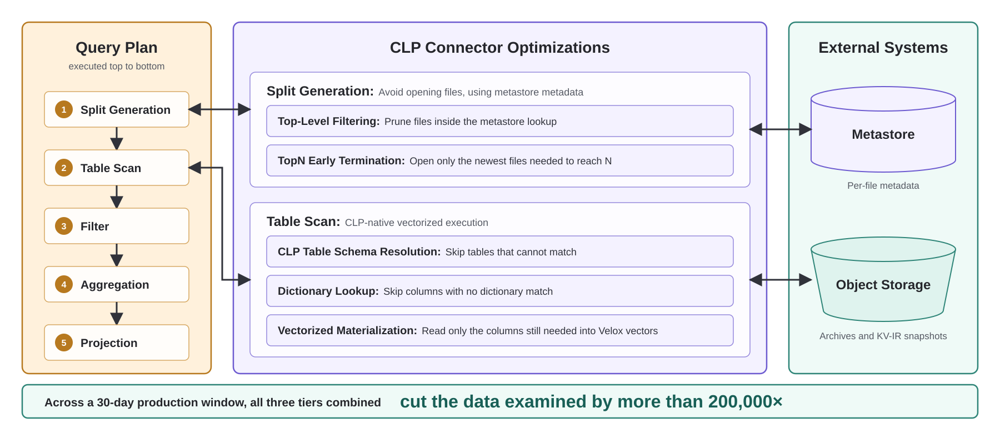

# Bringing Native SQL to Petabyte-Scale Semi-Structured Logs: Inside Uber's CLP and Presto Logging Infrastructure (Part III)

## Introduction

[CLP](https://github.com/y-scope/clp) entered Uber as a cost-saving measure: our first blog[^clp-part-i] showed it cutting Spark's logging cost by two orders of magnitude. Our second[^clp-part-ii] marked the turn from saving to building, growing CLP into an end-to-end logging platform. Not long after, CLP became the standard practice for semi-structured logs at Uber, adopted for streaming infrastructure such as Kafka and Flink, and ML/AI platforms such as Ray and Michelangelo. These systems now collectively produce roughly 25 PB of logs per month, and the question is no longer what CLP saves but what it can do with that data, today and in what comes next.

At the current scale, engineers rarely know in advance the exact log messages they are looking for. Diagnosis is therefore exploratory: engineers work through a combination of relational operations to narrow the search space. For example, to investigate a sudden spike in failed ride requests surfacing in a Flink job's logs, engineers may `SELECT` the fields that matter, such as `timestamp` and `status_code`, to inspect the raw errors, `GROUP BY` fields such as `city_id` and `app_version` to isolate the failure, and perhaps `JOIN` logs across services to trace the failed requests end to end.

These relational operations map directly to SQL, which at Uber runs on Presto, a distributed query engine that federates a broad range of data sources. Semi-structured logs are conventionally an awkward fit, since relational engines expect rigid, pre-defined schemas while logs carry dynamic schemas with type polymorphism across events. CLP removes that constraint by inferring each log's schema during ingestion, so a Presto CLP connector could read the CLP format while supporting native SQL operations.

Native SQL was only the first step. A production system on petabytes of logs must answer interactive queries fast without sacrificing freshness, and the convention for performance-critical systems at that scale is to scale out to hundreds or even thousands of query workers. We took a different route, and it grew the project from a simple connector into a complete logging infrastructure at Uber. Query performance comes from adding a metastore and a CLP-native engine that aggressively prune unrelated data. Freshness comes from integrating CLP's streaming Key-Value Intermediate Representation (KV-IR) during log collection, which keeps new events compressed and searchable while data is still arriving. Instead of hundreds or thousands of workers, five were enough to serve production logging at petabyte scale.

The cluster is at a maintainable scale, but the maintenance burden moved elsewhere. We initially kept the CLP connector inside the Presto repository, and reconciling upstream changes with Uber-specific customizations on every rebase is costly enough that Uber's Presto team actively maintains only the Hive connector. What we needed was a decoupled plugin: an artifact the Presto team downloads and loads into Presto through configuration alone.

This is how the [Presto CLP connector](https://github.com/y-scope/clp-plugin-presto-connector), led by Uber's Observability, Presto, and Storage Platform teams together with YScope, became the first plugin connector in PrestoDB for both the Presto coordinator and native worker,[^coordinator-spi] and a reusable pattern for future connectors. The problem was not unique to Uber: engineers at Meta and IBM faced it too when adopting new data formats without maintaining Presto forks.

When we proposed the plugin infrastructure to the PrestoDB community, many people engaged voluntarily and did most of the work. What we contributed was the piece that completed the design end to end, along with the production deployment that validated it at scale. The infrastructure shipped in Presto 0.299, and the companion [PrestoDB blog](PRESTO_BLOG_URL) covers the design in depth. This blog covers what Uber built on top of it.

## When Semi-Structured Logs Meet Native SQL

### How CLP Stores Semi-Structured Logs

With many platforms emitting logs, a field such as `status_code` may arrive as a number in one log, a string in another, or wrapped in a nested object such as `request.status_code`, so the infrastructure must accept data as-is and derive structure automatically. CLP infers schemas at ingestion time: it incrementally builds a schema tree of every observed field path and type, then groups log events with identical schema into a table. The resulting set of tables, together with their schema metadata, is bundled as a self-contained archive, CLP's basic storage unit.

Because archive tables are derived from raw input on the fly, new fields and types extend the schema tree without a rebuild or migration. Rather than scanning wide, sparse tables filled with empty values, CLP checks the query against its schema tree and reads only the tables that match the requested field and type. As demonstrated in [our OSDI '24 paper](https://www.usenix.org/conference/osdi24/presentation/wang-rui), published jointly by YScope, the University of Toronto, and Uber, CLP achieves **2.47× to 8.09× faster query performance** compared to databases like ClickHouse and PostgreSQL, on datasets drawn largely from Uber's production logs.

For natural-language fields such as log messages, CLP also separates recurring static text, stored once as **logtypes**, from changing, typed variables. Both remain linked to the original events. That separation pays off twice later in this blog: search can skip whole columns that cannot match, and an agent could learn what happened, and how often, without reading a single event.

### How CLP Integrates with SQL

To allow Presto to query CLP's dynamic columns, we added a handful of `CLP_GET_<TYPE>(<json_path>)` UDFs in the connector, where `<TYPE>` is the column's Presto type and `<json_path>` its JSON path. For instance, to reference `request.status_code` as an integer, a user could call `CLP_GET_BIGINT('request.status_code')`. If an archive has no column with that name and type, it simply contributes no rows. Inside the connector, the UDF's path and type pinpoint the matching columns across CLP's many tables, delivering native CLP query speed. These UDF calls are also what the connector later pushes down into CLP.

One more UDF, `CLP_GET_JSON_STRING()`, retrieves the entire record, which is otherwise impractical when every record may have a different schema.

The [Presto CLP connector documentation](https://docs.yscope.com/presto/connector/clp.html) lists the full set of supported UDFs.

## Uber's Logging Infrastructure: System Overview

Figure 1 shows the architecture of Uber's logging infrastructure and the life cycle of a log along its two paths, ingestion and search, and the consolidation step that bridges them.



**Figure 1: System overview of Uber's logging infrastructure**

### Ingestion

CLP archives are built once from a fixed batch of semi-structured data and compress best when that batch is large, since compression depends on repetition across many events. Small batches would mean a flood of tiny, poorly compressed archives, but a single container typically takes far too long to accumulate a batch large enough to compress well, and failure diagnosis cannot wait. **KV-IR**, CLP's append-only, row-based streaming format, resolves this by compressing events incrementally as they arrive and keeping them searchable mid-write. Every schema-tree node is written before the first event that references it, so any prefix of a KV-IR file is readable on its own. The pipeline therefore has two stages: events are compressed into KV-IR per container for freshness, then KV-IR files from many containers are consolidated into one archive.

The ingestion pipeline begins at the edge, where application containers emit semi-structured logs to the local filesystem. A per-host log collector encodes these log files on the fly into KV-IR. Either at a set interval or following a configurable publication policy, described in our second blog,[^clp-part-ii] it uploads the growing file to object storage, replacing the previous snapshot with a longer one, so the latest events are searchable before the file closes.

Meanwhile, the collector streams metadata updates for each upload to Kafka. We capture rich metadata for later optimization: per-file details such as its time range, event count, and whether it is still open, plus context like zone or host ID that is only available at the edge. A polling process consumes them from Kafka and persists them into a relational metastore.

### Consolidation

Consolidation bridges the two stages. Once a policy-defined batch of closed KV-IR files is registered in the metastore, an asynchronous process merges them into one archive, writes it to object storage, and registers it in the metastore too. Because horizontally scaled containers emit similar logs, a batch merged across many of them is both large and highly repetitive, exactly what CLP compresses best. The archive is also cheap to build. Parsing is light on any one host but expensive to process centrally at Uber's volume, so it happens once at the edge, where the fleet forms a massively parallel parsing layer. Because KV-IR already carries each event's structure and encoded values, consolidation never parses anything a second time.

### Search

Engineers and agents issue debugging and analytics queries either through Uber's observability stack, which translates them into SQL and routes them to a Presto cluster, or as SQL sent to Presto directly.

Presto parses the query into a query plan, the sequence of steps it will execute, and our CLP connector steps in to optimize those steps for semi-structured data. It first consults the metastore to prune candidate files before any is opened. Because a consolidated KV-IR file's events also exist in an archive until it is purged, the metastore also marks one representation as authoritative, so a query never sees duplicates. The remaining files and any predicates metadata could not resolve go to the CLP-native execution engine, which evaluates them on the compressed representation without full decompression, and Presto evaluates whatever the connector cannot push into CLP.

## Implementation Details

The optimizations below follow the two paths from the system overview: ingestion first, then search.

### Ingestion Optimization

#### Near Real-Time Query Freshness

Once the metastore receives a snapshot's metadata update, its new events are immediately queryable. End to end, an event is typically searchable within 30 seconds to a few minutes of being written. Publishing at an interval or by policy keeps each collector's update rate low, but across hundreds of thousands of containers it still adds up to thousands of metadata updates per second at peak. Our metastore sustains more than 10,000 `UPSERT` operations per second per table using MySQL's `INSERT ... ON DUPLICATE KEY UPDATE`, well above the observed peak.

#### Policy-Guided Consolidation

Because closed KV-IR files remain queryable, consolidation does not have to begin immediately: a planner waits for a useful batch, then groups related files using file metadata and a pluggable, table-specific policy that can be tuned with domain knowledge about how each workload is queried. A policy might group logs from the same service within a shared time window, keeping similar schemas and recurring text together, or group logs from different layers of a stack that are commonly queried together, reducing the number of archives a query has to open and improving search locality.

### Search Optimization

Recall that Presto turns a query into a plan of steps executed top to bottom. For a typical log query, those steps are split generation, table scan, filter, order-by, and projection. Split generation decides which files to read and packages them as splits, the units of work handed to workers. Table scan reads those splits, and the remaining steps operate on the rows that come back. Split generation runs on the coordinator and table scan on the workers, and the coordinator also decides which predicates to push down and which fields the workers must read for the filters, aggregations, joins, and projections still to come, which is why the connector needs a foothold on both sides.

Our CLP connector intervenes in those first two steps. During split generation it applies two tiers of optimization, top-level filtering and TopN early termination, that use metastore metadata to avoid opening files at all. During table scan it applies a third, CLP-native vectorized execution, to read as little as possible from each file it does open. Figure 2 shows where each sits in the plan.



**Figure 2: CLP connector optimizations in the Presto query plan**

#### Top-Level Filtering

When a SQL predicate matches metadata registered during ingestion, such as a timestamp or service field, the connector appends it to the metastore lookup query rather than fetching every candidate KV-IR file and archive and leaving the filtering to Presto. The candidate list it receives is already filtered at the file level.

#### TopN Early Termination

Investigative queries are predominantly of the form "find the N most recent matching events." Without knowing how many events a file holds before opening it, the connector would have to scan every matching candidate to be sure of N results. The key, again, lies in the metastore, which holds each file's event count from ingestion. When a query asks for the N most recent events, the connector retrieves these counts, orders the candidates newest first, and opens only the newest files needed to reach N. Stopping the moment the count reaches N is only an approximation, since an unopened file whose time range overlaps those counted may hold a newer match. For an exact answer, the connector keeps going until no remaining file can be newer than the N it has found.

#### CLP-Native Vectorized Execution

Once a split is open, CLP itself narrows the work in three steps.

**CLP table schema resolution:** During schema resolution, CLP matches the structure implied by a query against each table's schema and keeps only the tables that could contain a match. For example, if a query filters on `zone`, any table whose schema contains no `zone` field cannot hold a match and is skipped without any scan.

**Dictionary lookup:** This applies specifically to logtypes and their variables, not every column: each is stored once in a dictionary with an ID. Checking that dictionary first means a column with no match is skipped before any row is scanned, and a query can match on the pattern, a specific variable, or both, instead of comparing whole strings.

**Vectorized materialization:** Materialization happens last. At the matching rows only, the connector reads whatever columns downstream steps still need: the final projection, the inputs to any aggregation or join, and the columns behind filters that could not be pushed down. It fills them directly into Velox vectors, since CLP's storage is already columnar.

## Results So Far

Stored in CLP, the roughly 25 PB of logs we produce each month occupies 750–850 TB in object storage, about 97% less.[^compression-comparison]

Across a 30-day production window, the three search optimization tiers cut the data examined by more than 200,000×, the combined effect of all three rather than any one alone.[^work-reduction] That reduction is why a five-node Presto cluster, reading directly from object storage with no cache, serves hundreds of weekly active users (WAU) and completes thousands of successful queries per day, with a mean response time of roughly two seconds and 99% completing within 26 seconds. The workers typically sit at 5–10% CPU and memory. A cluster serving this workload should be busy, and it is not, because the tiers above removed the work before it reached a worker. What remains is headroom, spent deliberately: rather than maximizing scan throughput, we cap the cluster's object-storage read rate and parallelism to avoid disrupting other workloads while still meeting latency needs. The lightweight design also keeps operational overhead low, requiring only a few engineers to maintain the entire infrastructure.

## What Comes Next: Beyond Guesswork for Agents

Adding SQL syntax was not the hard part. The hard part was keeping petabytes of evolving logs fresh, compact, and queryable while preventing most of that data from ever becoming query work. KV-IR, consolidation, the metastore, CLP's own structure, and a plugin path for the connector each remove a piece of that work, and the numbers above are what is left. The same structure that makes queries cheap is also what comes next.

Agents already issue more than half of CLP queries at Uber, and they start at a disadvantage. A fixed-schema table has a known list of columns. Evolving logs do not, so agents guess field names and write broad searches such as `message LIKE '%failed%' OR message LIKE '%error%'`. Narrow guesses miss, and broad ones bury. What an agent needs is an inventory of the slice in front of it: which fields exist, which message formats occur, and how often. CLP already has that inventory in its compressed representation: the schema tree of field paths and types, and the logtype and variable dictionaries the third tier uses to narrow each scan, each stored once and linked to its source events.

Three questions cover that inventory, and we are refining a SQL function for each: `SCHEMA()` answers what fields are available by returning the paths and value types below a field, `PATTERN()` answers what happened and how often by exposing message formats that SQL can group and count, and `SEMANTIC()` answers which formats are relevant by matching meaning rather than exact wording. All three consult metadata rather than data, so their cost tracks the number of distinct formats rather than the number of events. For example, asked to triage connector errors, an agent calls `SCHEMA('message')` to find where the relevant text lives, then runs:

```sql
SELECT
    PATTERN('message.content[*].content') AS failure_pattern,
    COUNT(*) AS occurrences
FROM clp.coding_agent_sessions
WHERE SEMANTIC('message.content[*].content', 'native connector load failure')
GROUP BY PATTERN('message.content[*].content');
```

| failure pattern | occurrences |
| --- | --- |
| Failed to load connector library **`%library_path%`**: undefined symbol **`%symbol%`** | 47 |
| Connector factory **`%factory_name%`** was not registered | 19 |
| Could not open shared object file **`%file_path%`** | 6 |

A text search for `fail` or `error` would miss the third pattern entirely, since its message contains neither word, and a search broad enough to catch it would bury it. Grouped by pattern, the rare failure is a visible row, and the agent can retrieve exactly those six events.

The placeholders in that table, `%library_path%` rather than a generic type such as `int`, `float`, or `str`, come from CLP+, an experimental extension of CLP that tags each variable's role at ingestion, mostly automatically. Because a role is assigned once per format rather than once per event, tagging stays cheap. And once a value is known to be, say, a job ID, every event that mentions that job can be linked together, whatever format each came from.

Tying events together is also where the observability industry is heading, under a name of its own. A **wide event**, as several platforms now call it, is one record per request or operation carrying the fields of its logs, its trace, and its metrics together. We already have the pieces: [Jaeger](https://www.jaegertracing.io/) records a request's path across services as spans, [M3](https://m3db.io/) and a growing [OpenTelemetry](https://opentelemetry.io/) footprint collect its metrics, and the trace ID ties them together, since spans and logs carry it and metrics can too when configured. A wide event would join them once, at ingestion, so an agent reads one record instead of visiting three systems. Not every log has a trace or metric, and not every trace or metric has a log, so one record may carry three signals and the next only one. Records whose shape changes from one event to the next are what CLP was built to absorb.

CLP entered Uber to cut a bill. What it stores now is the shape of everything Uber logs, and that shape, not a new index, is what would let an agent see what happened without reading all of it.

[^clp-part-i]: ["Reducing Logging Cost by Two Orders of Magnitude Using CLP"](https://www.uber.com/en-GB/blog/reducing-logging-cost-by-two-orders-of-magnitude-using-clp/) showed how streaming CLP compression reduced storage and SSD writes for Spark logs and pointed to familiar SQL access through Presto as a next step.

[^clp-part-ii]: ["Modernizing Logging at Uber with CLP (Part II)"](https://www.uber.com/gb/en/blog/modernizing-logging-with-clp-ii/) described production ingestion, retention, and log viewing.

[^coordinator-spi]: Plugin support for the Presto coordinator already existed through Presto's Java Service Provider Interface (SPI). What did not exist was a way to plug a connector into the Presto Native (C++) worker without maintaining a fork, the gap these changes closed.

[^compression-comparison]: Our first blog reported 169× compression for Spark messages alone. The current aggregate figure covers a broader set of workloads whose records include operational fields such as hostnames, tags, and high-cardinality trace IDs (UUIDs). High-cardinality trace IDs are nearly unique and give the compressor little repetition to exploit. Even so, the aggregate compression ratio still works out to roughly 97% less storage.

[^work-reduction]: The figure divides the aggregate number of events covered by successful queries' time ranges during the 30-day window by the aggregate number of events those queries examined after top-level filtering, exact TopN early termination where applicable, and CLP-native filtering.
