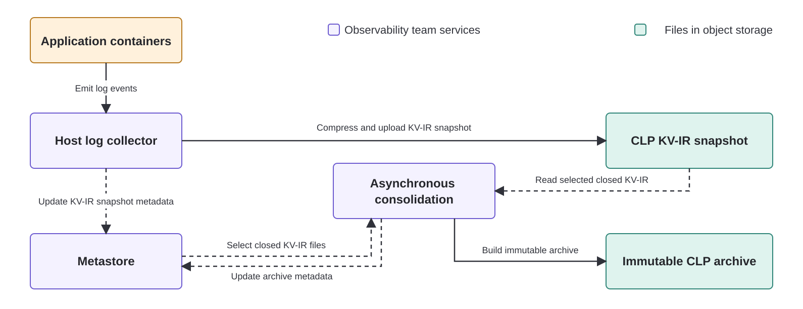

# Bringing Native SQL to Petabyte-Scale Semi-Structured Logs: Inside Uber’s CLP and Presto Infrastructure (Part III)

At Uber, the [Compressed Log Processor (CLP) platform](https://github.com/y-scope/clp) handles semi-structured logs from machine learning and AI platforms such as [Ray](https://www.ray.io/) and [Michelangelo](https://www.uber.com/us/en/blog/michelangelo-machine-learning-platform/), streaming platforms such as [Flink](https://flink.apache.org/) and [Kafka](https://kafka.apache.org/), and analytics platforms such as [Spark](https://spark.apache.org/). Together, these workloads produce about 25 PB of logs per month before compression. Yet just five 48-core [Presto Native](https://prestodb.io/docs/current/presto-cpp.html) workers serve hundreds of users each week and execute thousands of successful queries each day. How can such a small cluster make interactive SQL practical at that scale?

This is the third blog in Uber’s CLP series. [“Reducing Logging Cost by Two Orders of Magnitude Using CLP”](https://www.uber.com/en-GB/blog/reducing-logging-cost-by-two-orders-of-magnitude-using-clp/) showed how streaming CLP compression reduced storage and SSD writes for Spark logs and pointed to familiar SQL access through Presto as a next step. [“Modernizing Logging at Uber with CLP (Part II)”](https://www.uber.com/gb/en/blog/modernizing-logging-with-clp-ii/) described production ingestion, retention, and log viewing.

As CLP adoption expanded, investigations spanned more hosts, application versions, and time ranges. Engineers often start with a symptom or question rather than an exact field or message. They need to discover evolving fields and types, find and count recurring patterns, compare behavior across selected events, and perhaps join logs with related datasets. Uber’s mature Presto query ecosystem, with established governance, access control, and tooling, was the natural place to provide these capabilities.

Making this practical required more than a SQL interface. The storage path had to preserve changing paths and conflicting types, keep arriving events compressed and searchable, and consolidate closed data for better compression and faster search without interrupting access. At query time, simple time-range pruning was not enough. We use metastore metadata to remove files that cannot match, skip older files that may match but cannot change a query's latest results, and use CLP’s stored structure, message formats, and values to narrow each selected scan. In aggregate across a 30-day production window, successful queries’ time ranges covered more than 200,000 times as many events as the system ultimately examined.[^work-reduction] This article follows that design from storage through query execution, reports its production results, and shows how the same metadata could later give agents compact context before they retrieve exact evidence.

## Organizing Evolving Logs for Columnar Compression and Search

Uber's logging platform cannot control the structure of the events it stores. Two versions of the same application often run at once, so a field such as `status_code` may arrive as a number from one, a string from another, and nested inside an object from a third. Fields appear, move, and change type without warning, and users still expect every one of them to remain searchable. A **field path** identifies a location inside an event: `event.request_id` is `request_id` inside `event`.

Uber stores these logs in CLP, which losslessly preserves each source file's path, every event's nested structure and values, and the order of events within each file. Rather than storing each event as a single document, CLP organizes every observed field path and value type for columnar access within each archive. It requires neither a global schema nor a predefined list of important fields.

Think of a CLP archive as a collection of small internal tables. Events with the same nested field paths and corresponding value types share a table, where each field becomes a column of encoded values of one type. For natural-language text such as log messages, CLP identifies the static text shared by similar messages and stores it as a recurring format called a **logtype**, encoding the changing parts such as library paths, IDs, and counts separately while preserving their types. An archive-local schema tree maps each observed combination of field path and value type to the tables and columns that store its values.

Because CLP derives each archive's layout from observed data, new fields and type changes are absorbed during compression without a global schema update, and each shared schema is stored once rather than repeated with every event. Values that share a field path and type sit together, which compresses well, and dictionaries avoid repeating logtypes and values. The same organization narrows a search: the schema tree selects only the tables and columns that can hold a matching field of the requested type, dictionaries rule out patterns and values that cannot match, and CLP reconstructs a complete event only when one is requested. The [μSlope paper from OSDI '24](https://www.usenix.org/conference/osdi24/presentation/wang-rui), joint work by YScope, the University of Toronto, and Uber, describes the formal layout.

> ### Four ways to store an evolving event
>
> One file format can support several of these layouts, so the comparison is between layouts rather than formats.
>
> | Layout | What must be decided before writing | Field search | Structure inside message text |
> |---|---|---|---|
> | One document per event, such as a JSON object | Nothing | Document navigation unless paths are separately indexed | None |
> | One typed column per predefined field | Every field path and value type | Values for the requested field are scanned directly | None |
> | Document plus selected typed columns | Which paths deserve their own columns | Direct scans for chosen paths, navigation for the rest | None |
> | CLP | Nothing | Only relevant encoded columns and values are scanned | Recurring text stored once, variables typed and separated |
>
> The cost sits on the other side of the ledger. CLP is specialized storage with its own query integration, which is what the rest of this article is about.

Archives therefore provide high compression and selective search once data is consolidated.

## Compressed and Queryable from Arrival through Archival

Recent logs must remain searchable for incident diagnosis, rollout validation, and active-job monitoring. Building an immutable archive for each small batch of container logs would create many tiny archives, while waiting for a larger batch would delay search. Uber avoids this tradeoff by writing arriving events to an appendable, compressed [**key-value intermediate representation (KV-IR)**](https://docs.yscope.com/clp/main/dev-docs/design-kv-ir-streams/index.html) stream and asynchronously consolidating closed KV-IR files into immutable CLP archives.



**Figure 1: KV-IR snapshots keep arriving data compressed and searchable. Closed KV-IR files are consolidated asynchronously into columnar archives, and queries span both forms without duplicates.**

Configurable conditions trigger snapshot uploads without closing the local stream. After the metastore processes the corresponding metadata update, new events are typically queryable within 30 seconds to a few minutes.

The surprising part is that this fresh-data path does not force archive construction to parse and encode the same events from scratch. KV-IR remains directly searchable as it grows, while consolidation reuses its structured, encoded representation.

> ### KV-IR makes an intermediate representation searchable as it grows
>
> A compiler typically transforms source code into an intermediate representation (IR) before producing optimized output. CLP similarly transforms incoming events into a structured, encoded form before building columnar archives. KV-IR serializes that intermediate form incrementally as events arrive, keeping every complete readable prefix searchable.
>
> **Parsing on any one host is modest, but repeating it centrally across Uber's full log volume would make consolidation far more expensive.** Host log collectors perform this work as events arrive, forming a massively parallel parsing layer across Uber's fleet. Each collector identifies event nesting and value types and separates recurring static text, stored as logtypes, from typed variables.
>
> KV-IR then writes references to the evolving schema tree alongside encoded values rather than streaming self-contained documents. Conceptually, each event is already a row ready for its matching internal table. Archive construction can route the encoded values into columns without parsing the original event again.
>
> Each new schema-tree node is written before the first event that refers to it, so every complete readable prefix contains all the structure needed to interpret its events. Although *intermediate* describes its position in the data flow, KV-IR is appendable and compressed, and its published snapshots are durable, directly searchable production data.

A KV-IR file is queryable whether it is still growing or already closed. The aggregation service takes only closed files, waits until it has a group worth consolidating, then dedicated workers build the archive, deduplicating structure, logtypes, and values across the whole group to improve compression and speed up columnar search. Because that work runs on its own service and its own machines, neither ingestion nor queries wait for it.

Until source KV-IR files are purged, the same events exist in both forms. The metastore picks one representation for each logical log file, preferring an archive and, among archives, the newest. The connector exposes both forms as one duplicate-free logical table.

## Native Semi-Structured Querying with Presto

To engineers, recent KV-IR and consolidated archives look like one Presto table. They can query that table with SQL without knowing where an event is stored. Uber also accepts familiar Lucene-style searches and translates them into the same SQL path, preserving existing access controls and query tools.

Underneath this familiar interface, Presto's Java coordinator plans each query. Inside [Presto Native](https://prestodb.io/docs/current/presto-cpp.html) C++ workers, the connector pushes supported field reads and filters into CLP, which searches its compressed representation directly instead of reconstructing every event as a document.

Frequently used fields, such as `timestamp` and `event.request_id`, appear as ordinary typed columns. The [open-source connector](https://github.com/y-scope/clp-plugin-presto-connector) also exposes supported fields through [typed SQL functions named `CLP_*`](https://docs.yscope.com/presto/connector/clp.html). Each function's name gives Presto a stable return type even when a field is absent or has another type in some events. These functions support exact paths, wildcard path segments, and typed value searches across fields. `CLP_GET_JSON_STRING()` reconstructs the complete event only when requested.

The main access forms fit in one query:

```sql
SELECT
    timestamp, -- ordinary table column
    event.request_id, -- ordinary string column
    CLP_GET_STRING('event.request_id'), -- same stored path through a typed function
    CLP_GET_JSON_STRING() AS event -- complete event without a declared schema
FROM clp.platform_logs
WHERE timestamp >= current_timestamp - INTERVAL '30' DAY
  AND CLP_GET_BIGINT('event.*.status_code') >= 500 -- wildcard path with integer values
  AND CLP_WILDCARD_STRING_COLUMN() LIKE 'OutOfMemory%' -- string in any field
ORDER BY timestamp DESC
LIMIT 100;
```

All these access forms use the same CLP-native execution path. Exposing a path as an ordinary column does not create another stored copy. The connector hides substantial complexity behind this simple interface. For implementation details, see the companion **[PrestoDB blog on the pluggable CLP connector](PRESTO_BLOG_URL)** and [YScope's optimizer walkthrough](https://blog.yscope.com/querying-clp-compressed-logs-with-prestosql-71dff29a0b82).

## How Five Workers Serve the Workload: Avoiding Work at Every Layer

Typed SQL explains how engineers use the system. Avoiding work explains how five workers can serve it. Returning 100 rows can still be expensive if Presto schedules every file in a 30-day range and examines every event. Uber narrows that work at three progressively finer levels: files that cannot match, older files that latest-N planning can avoid scheduling, and irrelevant structures inside each selected CLP scan.

**1. Prune files that cannot match.** The metastore maintains per-file event-time bounds and dimensions such as application, host, job, and correlation ID, then compares query filters with that metadata. If a file cannot match, Presto never creates a split for it. A split is the unit of work assigned to a worker, so no worker opens that file. This familiar optimization is effective, but it still keeps every file that might contain even one match.

**2. Avoid scheduling older files for latest-N queries.** Most log searches ask only for the latest `N` matches with `ORDER BY timestamp DESC LIMIT N`. File pruning keeps every file that may match, even when its matches are too old to enter the result. Without limit-aware file selection, Presto must process every file left after pruning before it can guarantee the latest `N`. Uber's metastore instead considers the remaining files newest first and, when conditions allow, stops before unnecessary older files become splits.

This is not another form of pruning. A skipped file may contain valid matches. Deciding that those matches cannot change the answer requires reasoning across file time bounds and matching-event counts. The obvious stopping rule is subtly wrong. The callout explains the trap and how the guaranteed and approximate modes handle it.

> ### Why stopping after N matches can be wrong
>
> The tempting implementation is to order pruned files by descending `max_timestamp`, add their matching-event counts until the total reaches `N`, and stop. An unselected file may overlap the time bounds of selected files and contain events newer than some already counted results.
>
> **Reaching `N` establishes a watermark. It does not yet make every older file irrelevant.**
>
> **Approximate mode.** Users explicitly choose this mode when lower latency matters more than an exact latest-N result. The metastore receives pruned files in descending `max_timestamp` order and accumulates the available per-file event counts for supported filters. When the count first reaches `N`, it sets a watermark at the lowest `min_timestamp` selected so far and returns immediately. This schedules fewer files, but an omitted file overlapping the watermark may contain events that belong in the true latest `N`. The tradeoff can be worthwhile for rapid exploration.
>
> **Guaranteed mode.** This mode preserves the exact latest-N result. With files ordered by descending `max_timestamp` and accurate bounds for the query's timestamp field, the metastore accumulates exact matching-event counts until they reach `N` and sets the watermark at the lowest selected `min_timestamp`. It then includes every remaining file whose `max_timestamp` is at or above the watermark and stops when the next file is strictly below it. The counts must account for every remaining filter. If any filter cannot be counted exactly, guaranteed mode returns every file left after pruning.
>
> Both modes run before split creation, so skipped files are never scheduled or opened. The same logic runs in reverse for `ORDER BY timestamp ASC LIMIT N`. If the metastore streams ordered candidates, it can also stop retrieving file metadata early.

**3. Narrow each selected CLP scan.** A selected scan may still cover many events, fields, and recurring messages. The connector passes supported filters and requested fields directly to CLP, which uses the schema tree and dictionaries described earlier to reach only the encoded streams that can match. Presto evaluates whatever the connector could not delegate.

In aggregate across a 30-day production window, successful queries' time ranges covered **more than 200,000 times as many events** as the system ultimately examined after all three layers.[^work-reduction] The achievement is not scanning petabytes quickly. It is avoiding almost all of that work.

During planning, Uber's query layer automatically flags queries that exceed configured thresholds and suggests narrower time ranges or metadata filters. This is a guardrail, not a rejection. Users can run the original query when its full scope is intentional, although genuinely large queries still take time.

## Results in Production

Each month, the workloads described above produce approximately **25 PB** of log data before compression. Stored in CLP, their reported object-storage footprint is **750–850 TB**, about **97% less physical storage**.[^compression-comparison]

In the same 30-day production window, **five nodes**, each running one 48-core Presto Native worker, served **hundreds of users per week** and completed **thousands of successful queries per day**. Workers streamed selected data directly from object storage without relying on a cache. Successful queries had a mean response time of roughly **two seconds**, and **99% completed within 26 seconds**.

Uber's CLP query deployment balances interactive query performance with a small footprint on shared infrastructure. Rather than maximizing scan throughput, we deliberately limit our object-storage read rate and parallelism to avoid disrupting other workloads while still meeting users' latency needs. Across a longer observation period, workers typically used **5–10% of their CPU and memory**, with light network and I/O use. The remaining capacity provides headroom as demand and scope grow. A few engineers maintain the system alongside their broader platform responsibilities.

## What Comes Next

With the production path established, the same metadata and compressed structure can support smarter storage decisions and help agents explore unfamiliar data with less guesswork.

### Better Storage Decisions from Existing Metadata

**Indexing only what needs it.** A fully indexed tier earns its cost for data queried constantly under tight latency requirements. Much data is not. Because CLP preserves the original events losslessly and stays queryable, it could serve as the default tier, with a faster index provisioned only where access patterns justify it. How often a table is queried, which fields and time ranges those queries touch, and how long it must be retained are all things the metastore already records. If demand rises again, the index could be repopulated from CLP with the exact events, so shrinking it is reversible.

**Metadata- and domain-guided consolidation.** Schema, logtypes, sources, query history, and platform knowledge could guide which files share an archive. Structural similarity could improve deduplication and compression. Keeping data queried together, such as Spark driver and executor logs, could reduce archive opens. Time range, retention, freshness, and archive-size limits would still constrain each group.

### Beyond Guesswork: CLP Context for Agents

While compressing, CLP extracts the semantics of what it stores: the structure of each event, the recurring formats behind similar log lines, and the variables pulled out of them. This metadata is small, and it grows with the number of distinct structures rather than the number of events, so it stays roughly the same size whether it describes an hour of logs or a month.

That makes a class of questions answerable without reading any events at all. Which fields exist in this slice and what types they hold. Which message formats occur, and how often. Queries that do need events start from a far smaller candidate set, because the metadata rules out most of it first.

Agents already issue more than half of CLP queries at Uber, for root cause analysis, behavior analytics, and exploratory debugging. They are the ones who need this most. An agent arriving at an unfamiliar table cannot ask what the columns are, because semi-structured logs have no fixed answer, and reading a sample surfaces the common formats while hiding the rare one it is looking for. Metadata gives it the whole picture at a size it can afford to hold in context.

Three SQL functions would expose it: the tree of paths and types in a filtered slice, the recurring formats behind matching events, and a way to select those formats by meaning rather than exact wording. The interface is designed. What it still needs is refinement and validation.

> ### From a vague question to three recurring failure patterns
>
> The names and syntax below are illustrative. These functions remain under development.
>
> An agent reviewing coding-agent session logs asks: **“Which native connector load failures recur?”**
>
> Session records nest their text several levels deep, so the agent starts with `SCHEMA('message')`, which lists the paths and value types stored below `message`. It finds the text at `message.content[*].content`.
>
> It then asks for load failures without knowing their wording, grouping the results by format:
>
> ```sql
> SELECT
>     PATTERN('message.content[*].content') AS failure_pattern,
>     COUNT(*) AS occurrences
> FROM clp.coding_agent_sessions
> WHERE SEMANTIC(
>     'message.content[*].content',
>     'native connector load failure'
> )
> GROUP BY PATTERN('message.content[*].content');
> ```
>
> Because CLP stores each recurring format once, `SEMANTIC()` compares the description against the archive's logtype dictionary rather than against every message, and an event qualifies when it carries a matching format. `PATTERN()` returns that format with its changing values replaced by named placeholders, illustrated below rather than stored as shown:
>
> | failure pattern | occurrences |
> | --- | ---: |
> | Failed to load connector library **`%library_path%`**: undefined symbol **`%symbol%`** | 47 |
> | Connector factory **`%factory_name%`** was not registered | 19 |
> | Could not open shared object file **`%file_path%`** | 6 |
>
> The agent reads three formats and their counts instead of 72 near-identical events, then retrieves the exact events it needs as evidence.

The metadata could carry more. Variables lifted out of message text are typed but unnamed. CLP records that a value is a string, not that the string is a library path. Naming them is bounded work, since a variable belongs to a format rather than an event, and CLP can pose a small question: one format string, one position, real values from that slot. Named that way, a `job_id` inside a message means the same thing as the `job_id` a query already filters on, and grouping related events becomes metadata work too.

## From Open Source to Production: Collaboration Across Teams and Companies

This production system grew from nearly five years of sustained collaboration across teams and companies. The public [CLP](https://github.com/y-scope/clp) and [CLP Presto connector](https://github.com/y-scope/clp-plugin-presto-connector) projects provide shared storage and query foundations. Production at Uber required additional query planning, integration with the metastore and query layer, and operational support.

YScope led the CLP connector's design and implementation and developed the production planning path, including latest-N file selection, in close collaboration with Uber's Presto, Observability, and Data Storage teams. Uber's Presto team worked with YScope on connector infrastructure. Observability shaped production requirements and workflows and operates the query service. Data Storage collaborated on the metastore and object-storage paths used for planning, consolidation, and query execution. IBM's Presto team and Meta's Presto and Velox teams also participated in design discussions, helping us test assumptions and refine the architecture.

The collaboration also produced reusable changes upstream. Supporting native connectors outside the Presto Native source tree required [runtime connector registration](https://github.com/prestodb/presto/pull/27653) and [connector-specific coordinator-to-worker serialization](https://github.com/prestodb/presto/pull/27652). YScope implemented and submitted both changes, IBM's Presto team reviewed them, and the broader PrestoDB community provided the open review and integration path. These changes made the CLP connector the first end-to-end pluggable connector for Presto Native and created infrastructure that future connectors can reuse.

## Conclusion

Adding SQL syntax was not the hard part. The challenge was keeping evolving logs fresh, compact, and queryable while preventing most of that petabyte-scale data from becoming query work. Appendable KV-IR keeps arriving events searchable, consolidated CLP archives improve compression and search, the metastore avoids scheduling unnecessary files, and CLP narrows each selected scan.

The broader lesson is that a common SQL interface does not require one physical storage model. Presto brings CLP data into Uber’s established query ecosystem and handles planning and distributed execution, while CLP preserves evolving structure and searches its compressed representation directly. That preserved structure is also the path forward: the metadata that avoids query work today can guide storage decisions and give agents compact context about unfamiliar data before they retrieve events.

[^compression-comparison]: The first blog reported 169× compression for Spark messages alone. The current aggregate figure covers a broader set of workloads whose records include operational fields such as hostnames, tags, and high-cardinality trace IDs (UUIDs). High-cardinality trace IDs are nearly unique and give the compressor little repetition to exploit. Even so, a reported object-storage footprint of 750–850 TB for 25 PB of source data corresponds to roughly 97% less storage.

[^work-reduction]: We divided the aggregate number of events covered by successful queries' time ranges during the 30-day window by the aggregate number of events those queries examined after metadata pruning, guaranteed latest-N file selection where applicable, and CLP filtering.
