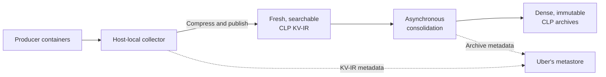
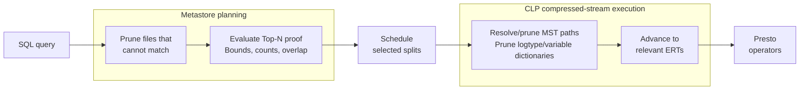

# Fresh Logs, Dense Archives, Native Semi-Structured Querying with Presto: CLP at Uber (Part III)

**Document status:** Working publication draft

At Uber, workloads in machine learning, artificial intelligence, streaming, and data platforms currently onboarded to the [Compressed Log Processor (CLP) platform](https://github.com/y-scope/clp) produce approximately 25 PB of raw semi-structured logs each month. Built to compress and search evolving semi-structured data, CLP reduces that volume to 750–850 TB. Yet five 48-core [Presto Native](https://prestodb.io/docs/current/presto-cpp.html) workers—Presto's C++ worker implementation—serve it directly from Uber's internal object storage, typically at 5–10% CPU utilization and without staging or caching complete archives. How can such a small query cluster provide SQL access at that scale?

This article continues Uber's CLP series. The first article, [“Reducing Logging Cost by Two Orders of Magnitude Using CLP”](https://www.uber.com/en-GB/blog/reducing-logging-cost-by-two-orders-of-magnitude-using-clp/), demonstrated compression and write-path savings for Spark logs. The second, [“Modernizing Logging at Uber with CLP (Part II)”](https://www.uber.com/gb/en/blog/modernizing-logging-with-clp-ii/), covered production ingestion, retention, and viewing. This third article follows that data into native semi-structured querying with Presto.

Compression is only part of the answer. Growing logs remain searchable before consolidation builds denser archives. Presto gives both forms one governed query path. Uber's metadata catalog, the CLP connector, and CLP's native storage and search engine then avoid work at different layers. The story begins with independently deployed producers.

## When Producers Control the Log Schema

Thousands of log producers deploy independently, so their schemas evolve continuously. One event may be natural-language text with embedded variables. Another may be nested JSON. Old and new versions coexist, and the same path may contain an integer, string, or object. The data is **semi-structured** because its fields are discoverable without one predefined schema, and **polymorphic** because one path can hold several value types.

The [second article in the series](https://www.uber.com/gb/en/blog/modernizing-logging-with-clp-ii/) explains how Uber preserved existing log messages while adding structured operational context during ingestion. A record can therefore contain natural language alongside typed fields and nested objects, even as its fields, nesting, and value types evolve independently. The [μSlope paper](https://www.usenix.org/conference/osdi24/presentation/wang-rui), published at OSDI '24, explains how CLP stores such evolving records. The work was a collaboration among [YScope](https://yscope.com/), the University of Toronto, and Uber's Observability, Pinot, and Storage and Search teams.

A global table schema would turn routine application changes into coordinated migrations. An opaque document avoids that coordination but forces search to rediscover structure.

## Fresh Logs: Searchable Before Archiving

A CLP archive achieves density by organizing many events together, but accumulating enough input can take too long for incident response. CLP therefore provides two searchable forms: a streaming-compressed **key-value intermediate representation (KV-IR)** for active data and dense, immutable archives for retention. Uber moves data through this lifecycle and publishes metadata for both.

[KV-IR](https://docs.yscope.com/clp/main/dev-docs/design-kv-ir-streams/index.html) extends the message representation introduced in the [first article](https://www.uber.com/en-GB/blog/reducing-logging-cost-by-two-orders-of-magnitude-using-clp/) to key-value events and makes CLP's semi-structured storage model streamable. When a new path or type appears, KV-IR updates its schema tree—the file-local inventory of structure—before the first event that uses it. Events reference that tree alongside their encoded values. A reader therefore sees complete structure at every readable point in the growing, compressed file.

The current deployment also moves compression out of each application's log appender and into a collector on every host. The collector monitors container logs, enriches events, and appends them to compressed KV-IR. Because it outlives producer containers, it can finish processing and publishing their emitted logs after they exit.

Following the publication design described in the [second article](https://www.uber.com/gb/en/blog/modernizing-logging-with-clp-ii/), configurable timers publish the current contents of an active KV-IR file and its metadata while the local stream remains open. The metastore makes each published version discoverable, so new events generally become searchable within 30 seconds to a few minutes. Freshness no longer waits for archiving.

## Dense Archives: Asynchronous Columnar Consolidation

For longer retention, Uber's aggregation service groups finalized KV-IR files into a consolidation job. An aggregation worker invokes CLP to combine them into one immutable archive, outside the freshness-critical path.

Consolidation neither reparses events nor rediscovers structure. CLP merges the input schema trees into the archive's **Merged Schema Tree (MST)**, which inventories observed paths and types. It routes each record into an **Encoded Record Table (ERT)** for its exact key-and-type shape. Each archive owns many of these internal tables. Within one ERT, values of the same path and type form homogeneous columns without null-padding unrelated shapes. CLP also separates recurring static text patterns, called **logtypes**, from their typed variables.

When a group contains similar inputs, CLP can reuse more schemas, logtypes, and values across files. This can improve compression and search locality, while policy balances object size, request cost, query latency, and parallelism.



**Figure 1: KV-IR makes active streams searchable. Asynchronous consolidation later creates denser archives, while Uber's metastore makes both forms discoverable.**

## Native Semi-Structured Querying with Presto

At query time, users need not know which form holds an event. Some use Lucene-style field and keyword expressions with pipes for projection and aggregation. Others write SQL. Uber translates the first form and validates both before they enter one governed Presto path, gaining its joins, access controls, and tooling.

The [open-source CLP connector](https://github.com/y-scope/clp-plugin-presto-connector) presents KV-IR and archives as one logical source. Each selected file becomes a **split**, a unit of work assigned to a Presto worker. One query may use both forms. During temporary overlap, Uber's metastore marks an archive authoritative only for its incorporated KV-IR files, preventing duplicate events.

Presto requires every expression to have a known result type, but a CLP path may be absent or polymorphic. Lakehouse users may recognize the logical problem from [Variant](https://parquet.apache.org/docs/file-format/types/variantencoding/), whose dynamic values retain nested types, and optional Parquet [Variant shredding](https://parquet.apache.org/docs/file-format/types/variantshredding/), which materializes selected paths. The preceding **[PrestoDB blog post](PRESTO_BLOG_URL)** compares those layers with CLP.

PrestoDB does not yet support Variant end to end, so the connector supplies a typed SQL surface. An optional table schema exposes common path-and-type pairs, such as `timestamp` and `application_id`, as ordinary columns. [Typed accessors](https://docs.yscope.com/presto/connector/clp.html) distinguish polymorphic values: `CLP_GET_BIGINT('status')` selects integers, while `CLP_GET_STRING('status')` selects strings. A typed wildcard tests values across unknown keys, and `CLP_GET_JSON_STRING()` reconstructs a complete event. Future standard Variant operators could replace the exact-path accessors without changing CLP storage or execution. Efficient unknown-key search would remain a CLP-specific storage operation. Today, a query can combine both:

```sql
SELECT
    timestamp,
    application_id,
    CLP_GET_STRING('event.request_id') AS request_id,
    CLP_GET_BIGINT('event.status_code') AS status_code
FROM clp.platform_logs
WHERE timestamp >= current_timestamp - INTERVAL '30' DAY
  AND application_id = 'example-application'
  AND CLP_GET_BIGINT('event.status_code') >= 500
  AND CLP_WILDCARD_STRING_COLUMN() LIKE 'OutOfMemory%'
ORDER BY timestamp DESC
LIMIT 100;
```

These functions look like user-defined functions (UDFs), but they mark planner intent rather than evaluate JSON row by row. The connector carries their constant paths, types, and supported operations into the native scan. YScope's August 2025 post, [“Querying CLP-compressed logs with SQL via Presto”](https://blog.yscope.com/querying-clp-compressed-logs-with-prestosql-71dff29a0b82), gives the full rewriting and pushdown walkthrough.

From there, a production query passes through four stages:

1. **Analyze.** Uber's query layer and the connector identify metastore filters, supported queries that request only the newest results, and operations CLP can execute.
2. **Select.** The metastore returns KV-IR and archive files while enforcing archive precedence. Presto schedules them as splits.
3. **Scan.** The connector running inside the worker selects the appropriate native CLP scan path. CLP applies supported filters and projections to the compressed object-storage stream without staging the complete file.
4. **Finish.** CLP reconstructs requested results. Presto evaluates remaining expressions and performs joins, aggregation, ordering, and delivery.

Here, **native semi-structured querying** means more than C++ execution: Presto retains governance and distributed relational planning, while CLP searches its encoded representation instead of expanding every event into JSON. The next section shows where that division avoids work.

## Exploiting Data Knowledge at Every Layer

For selective investigations, the five-worker deployment works because three layers narrow the search.

First, Uber's metastore tracks locations, storage forms, time bounds, counts, selected dimensions, paths, and statistics across billions of file records. Time, application, host, job, and correlation predicates can prove that a file cannot match. Presto creates no split and opens no object-storage stream for it. This is file pruning. The public connector remains metadata-provider independent.

Second, many investigations ask only for the newest matching events:

```sql
ORDER BY timestamp DESC
LIMIT N
```

Presto's distributed **Top-N** operator ordinarily consumes every scheduled candidate split before determining the newest `N` results. At Uber, we added a correctness proof during file enumeration, before Presto creates splits. Using file time bounds and exact matching-event counts, the provider can prove when older files cannot displace the newest `N` matches accounted for by files enumerated so far. Those older files never become splits, so workers never open them. This is distinct from pruning: an excluded file may contain matches but cannot change the requested Top-N.

The provider considers files by descending maximum timestamp. Once exact counts for supported file-level filters reach `N`, it records the earliest timestamp covered and includes every file whose range overlaps that point. It stops only when the next maximum timestamp is older. A row-level filter that prevents an exact proof triggers the complete pruned candidate set. Trustworthy time bounds and counts are essential. Append-only publication and ordering help but are insufficient alone. This optimization is an Uber production extension, not a current open-source feature.

Finally, each archive carries execution metadata near its beginning. The MST maps paths and types to ERT columns. Indexed logtype and variable dictionaries describe recurring text and values. The connector resolves exact paths or unknown-key searches against the MST and rules out irrelevant structures. CLP eliminates more nonmatches through the dictionaries before advancing to relevant ERTs and reconstructing requested results.



**Figure 2: File pruning removes data that cannot match. The separate Top-N proof uses time bounds, exact counts, and overlap handling to safely avoid creating splits for older files, with a complete fallback when no proof is possible. CLP metadata then narrows each selected archive.**

Broad searches remain expensive. The gain comes from avoiding each cost at the layer that understands it: file opens and transfers at the metastore, then decompression, parsing, and reconstruction inside CLP.

## Production Results

For the onboarded workloads, CLP reduces approximately 25 PB of raw monthly logs to 750–850 TB: roughly 29–33× compression and about 97% less storage. The [first article in the series](https://www.uber.com/en-GB/blog/reducing-logging-cost-by-two-orders-of-magnitude-using-clp/) reported 169× for the same Spark messages before current enrichment. Today's representation also carries hostnames, tags, and high-cardinality universally unique identifier (UUID) trace IDs, which contain little repetition. The ratios therefore measure different representations.

Five 48-core Presto Native workers serve both forms directly from object storage, typically at 5–10% CPU utilization. Uber paces storage access because responsive latency, not maximum scan throughput, is the objective.

During **[MEASUREMENT_WINDOW]**, the service supported **[WEEKLY_ACTIVE_USERS] weekly active users** and **[DAILY_QUERY_VOLUME] daily queries**, with average end-to-end latency of **[AVG_LATENCY_SECONDS] seconds** and 99th-percentile (p99) latency of **[P99_LATENCY_SECONDS] seconds**. These measurements must describe one query population. Monthly ingest is not per-query scan volume.

> **Publication evidence required:** Add one representative timestamp-only versus richer-metadata pruning comparison, and plot users and query volume over an approved measurement window. Define the operational scope before making a maintenance-effort claim.

These figures evaluate a serving system, not compression alone. Growing programmatic use points to what comes next.

## What Comes Next: Letting Metadata Drive the Data Lifecycle

Today, metadata describes and narrows data. Three future directions could make it drive placement, organization, and interaction. All remain future work.

**Intelligent tiering.** CLP is not intended to replace a fully indexed system serving hundreds of queries per second. Access, latency, and retention metadata could move colder data out of an expensive index while keeping it queryable in CLP. Rising demand could reload selected data into the index. Some streams may justify both tiers.

**Similarity- and policy-aware consolidation.** Schemas, logtypes, values, sources, and query history could identify similar KV-IR streams likely to be searched together. Greater reuse could improve compression and locality, while time, access, retention, freshness, and archive-size constraints govern placement.

**Laying the groundwork for agent search and discovery without guesswork.** Programmatic clients already share the production SQL path with humans. During **[MCP_MEASUREMENT_WINDOW]**, **[MCP_TRAFFIC_SHARE] of query traffic** came through a [Model Context Protocol (MCP)](https://modelcontextprotocol.io/docs/getting-started/intro) server that **[DEFINE: explain which tools or agents it connects to the SQL path]**. Yet agents still guess exact terms and paths: a narrow guess returns nothing, while a broad one returns too many raw events.

Two operations could help. `SEMANTIC(path, description)` could search by intent when wording is unknown. `PATTERN(path)` could expose recurring text patterns when an agent first needs to discover the data. This future query asks for [Claude Code](https://docs.anthropic.com/en/docs/claude-code/getting-started) tool-output patterns related to native connector loading failures:

```sql
SELECT
    PATTERN('message.content[*].content') AS failure_pattern,
    count(*) AS occurrences
FROM clp.claude_code_session_transcripts
WHERE CLP_GET_STRING('type') = 'user'
  AND SEMANTIC(
      'message.content[*].content',
      'tool output reporting a native connector load failure'
  )
GROUP BY PATTERN('message.content[*].content')
ORDER BY occurrences DESC;
```

In Claude Code transcripts, top-level `type` distinguishes user, assistant, and system records. Polymorphic `message.content` may hold text or typed blocks, including tool results. The query selects user records, searches tool-result content by meaning, and groups matches by pattern.

CLP could perform much of this work over structure it already deduplicates. Metastore filters and the MST would first narrow the candidates. Semantic matching could compare intent with unique logtypes and dictionary values before scanning ERTs. `PATTERN()` could enumerate stored patterns and frequencies without reconstructing repeated events, and `SUMMARY()` could synthesize that smaller result with representative evidence and source links. These interfaces still require design and evaluation, but the underlying structural and textual deduplication is what could make them practical at petabyte scale: operate on compact paths, patterns, values, and counts first, then retrieve individual events only when evidence is needed.

Together, these directions could make metadata embedded within CLP and operational metadata maintained above it active inputs to placement, consolidation, and retrieval.

## Open Source and Collaboration

Those directions build on a public core, but capability boundaries matter.

The open-source [CLP Presto connector](https://github.com/y-scope/clp-plugin-presto-connector) and [CLP repository](https://github.com/y-scope/clp) provide end-to-end semi-structured log compression and Presto querying. Current public capabilities include mixed KV-IR and archive queries, typed exact paths, expression rewriting, pushing filters and projections into CLP, typed value search across unknown keys, complete-event JSON, and pluggable metadata and split filtering.

Uber's production deployment adds its advanced metastore, billion-file metadata scale, proof-based Top-N planning, routing, reliability, and operational controls. The lifecycle projects described above are not current Uber production behavior or automatic open-source connector features.

YScope engineers led the connector implementation. IBM engineers and the Presto community supported the native connector infrastructure and review. YScope and Uber engineers extended and applied the architecture in production. Together, they let Presto retain one SQL and distributed execution model while a pluggable connector preserves storage-specific execution.

## Conclusion

At 25 PB per month, the goal is not to push every retained byte through five workers faster. It is to keep irrelevant work from reaching those workers at all.

The lifecycle does that without sacrificing producer independence or freshness. Host collectors make active streams searchable as KV-IR. Asynchronous consolidation builds denser columnar archives. Presto presents both through one governed query path. Uber's metastore narrows files, proof-based planning can avoid creating splits for older files, and CLP metadata guides each selected archive scan before values are reconstructed.

That is the transferable result: a common SQL and distributed execution layer can coexist with specialized semi-structured storage. Evolving data can remain faithful to its producers and still be served economically at production scale.
