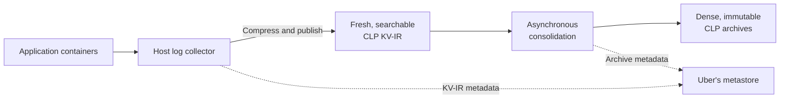

# Fresh Logs, Dense Archives, Native Semi-Structured Querying with Presto: CLP at Uber (Part III)

**Document status:** Working publication draft

At Uber, workloads in machine learning, artificial intelligence, streaming, and data platforms that now use the [Compressed Log Processor (CLP) platform](https://github.com/y-scope/clp) produce approximately 25 PB of raw semi-structured logs each month. Built to compress and search evolving semi-structured data, CLP reduces that volume to 750–850 TB. Yet five 48-core [Presto Native](https://prestodb.io/docs/current/presto-cpp.html) workers—Presto's C++ worker implementation—query it directly from Uber's internal object storage, typically at 5–10% CPU utilization and without staging or caching complete archives. How can such a small query cluster provide SQL access at that scale?

This blog continues Uber's CLP series. The first blog, [“Reducing Logging Cost by Two Orders of Magnitude Using CLP”](https://www.uber.com/en-GB/blog/reducing-logging-cost-by-two-orders-of-magnitude-using-clp/), demonstrated compression and write-path savings for Spark logs. The second, [“Modernizing Logging at Uber with CLP (Part II)”](https://www.uber.com/gb/en/blog/modernizing-logging-with-clp-ii/), covered production ingestion, retention, and viewing. This third blog follows evolving semi-structured logs end to end: how Uber keeps fresh data searchable, consolidates it into dense CLP archives, and queries fresh and archived data natively with Presto.

Compression is only part of the answer. Growing logs remain searchable before consolidation builds denser archives, and Presto queries fresh and archived data through the same path. Uber's metastore skips files that cannot match. The CLP connector pushes supported work into CLP, whose native storage and search engine works directly on the compressed data.

## When Applications Define the Log Structure

Thousands of applications and platform workloads emit logs at Uber. They evolve on different release schedules, and multiple versions of the same application may run at once. Their log fields, nesting, and value types therefore change continuously. One event may be natural-language text with embedded variables. Another may be nested JSON. The same path may contain an integer, string, or object. The data is **semi-structured** because its fields are discoverable without one predefined schema, and **polymorphic** because one path can hold several value types.

The [second blog in the series](https://www.uber.com/gb/en/blog/modernizing-logging-with-clp-ii/) explains how Uber preserved existing log messages while adding structured operational context during ingestion. A record can therefore contain natural language alongside typed fields and nested objects, even as its fields, nesting, and value types evolve independently. The [μSlope paper](https://www.usenix.org/conference/osdi24/presentation/wang-rui), published at OSDI '24, explains how CLP stores such evolving records. The work was a collaboration among [YScope](https://yscope.com/), the University of Toronto, and Uber's Observability, Pinot, and Storage and Search teams.

Requiring one global table schema would turn routine application changes into coordinated migrations. Storing each event as an untyped JSON string avoids those migrations, but every query must parse the string and rediscover its fields and types. CLP takes a third approach: it records structure as events arrive without requiring one schema for the entire dataset.

## Fresh Logs: Searchable Before Archiving

CLP uses a two-phase approach so logs remain compressed and searchable before archive construction. In the first phase, collectors stream events into appendable, compressed [**key-value intermediate representation (KV-IR)**](https://docs.yscope.com/clp/main/dev-docs/design-kv-ir-streams/index.html) files that can be searched while they are still growing. In the second phase, consolidation combines groups of closed KV-IR files into immutable, columnar archives for even better compression and faster search. Uber's metastore tracks KV-IR files and archives.

KV-IR extends the message representation introduced in the [first blog in this series](https://www.uber.com/en-GB/blog/reducing-logging-cost-by-two-orders-of-magnitude-using-clp/) to key-value events and carries their evolving structure in the same compressed stream. When an event introduces a new path or value type, KV-IR first writes the corresponding schema-tree update into the stream. It then writes the event as a reference to that streamed structure alongside its encoded values. When CLP reads the stream, it therefore has a complete schema tree for every event decoded so far, even while the file continues to grow.

In the current deployment, we moved compression out of each application's log appender and into a collector on every host. The collector monitors container logs, enriches events, and appends them to compressed KV-IR. Because the collector runs on the host rather than inside the application container, it can finish compressing and publishing logs after the container exits.

Similar to the mechanism in the [second blog in this series](https://www.uber.com/gb/en/blog/modernizing-logging-with-clp-ii/), the collector uses configurable timers to upload the current contents of an active KV-IR file and its metadata while the local stream remains open. Uber's metastore makes each upload discoverable, so queries can search new events within 30 seconds to a few minutes while the data is still in KV-IR.

## Dense Archives: Asynchronous Columnar Consolidation

For longer retention, our aggregation service groups closed KV-IR files into a consolidation job. An aggregation worker invokes CLP to combine them into one immutable archive. This work runs asynchronously, so it does not delay access to fresh logs.

Consolidation neither reparses events nor rediscovers structure. CLP merges the input schema trees into the archive's **Merged Schema Tree (MST)**, which records every observed path and value type. It routes each record into an **Encoded Record Table (ERT)** for its exact key-and-type shape. Each archive contains many of these internal tables. Within an ERT, each column holds one path and value type. Other record shapes go to other ERTs instead of adding nulls to this one. CLP further separates recurring static text patterns, called **logtypes**, from their typed variables.

Within a group of similar log files, CLP can deduplicate more schemas, logtypes, and repeated values across files. Grouping related data can also keep information likely to be queried together in fewer archives. We balance those benefits against object size, request cost, query latency, and parallelism.



**Figure 1: KV-IR makes active streams searchable. Asynchronous consolidation later creates denser archives, while Uber's metastore makes KV-IR files and archives discoverable.**

## Native Semi-Structured Querying with Presto

At query time, users don't need to know whether an event is stored in KV-IR or a CLP archive. Some use Lucene-style field and keyword searches with optional pipe commands to select fields or aggregate results. Others write SQL directly. Uber converts the Lucene-style searches and pipe commands to SQL, validates both generated and directly submitted SQL, and runs every query through the same Presto path, with its access controls and tooling.

The [open-source CLP connector](https://github.com/y-scope/clp-plugin-presto-connector) presents KV-IR and archives as one logical source. Each selected file becomes a **split**, a unit of work assigned to a Presto worker. One query may scan both KV-IR files and archives. After consolidation, an archive and the KV-IR files used to build it may briefly overlap in the metastore. The metastore selects the archive and omits only those input files. Other KV-IR files remain eligible, so one query can include fresh and archived data without duplicate events.

Presto requires every expression to have a known result type, but a CLP path may be absent or polymorphic. Lakehouse users may recognize this problem from [Variant](https://parquet.apache.org/docs/file-format/types/variantencoding/), whose dynamic values retain nested types, and optional Parquet [Variant shredding](https://parquet.apache.org/docs/file-format/types/variantshredding/), which materializes selected paths. The preceding **[PrestoDB blog](PRESTO_BLOG_URL)** compares those layers with CLP.

PrestoDB does not yet support Variant end to end, so the connector supplies a typed SQL interface. An optional table schema exposes common path-and-type pairs, such as `timestamp` and `application_id`, as ordinary columns. [Typed accessors](https://docs.yscope.com/presto/connector/clp.html) distinguish polymorphic values: `CLP_GET_BIGINT('status')` selects integers, while `CLP_GET_STRING('status')` selects strings. `CLP_WILDCARD_STRING_COLUMN()` searches string values across all fields without an exact field name. `CLP_GET_JSON_STRING()` returns the complete event as JSON. Future standard Variant operators could replace the exact-path accessors without changing CLP storage or execution. Efficient wildcard-key search would remain a CLP-specific storage operation. Today, a query can combine both:

```sql
SELECT
    timestamp,
    application_id,
    CLP_GET_STRING('event.request_id') AS request_id,
    CLP_GET_BIGINT('event.status_code') AS status_code
FROM clp.platform_logs
WHERE timestamp >= current_timestamp - INTERVAL '30' DAY
  AND application_id = 'example-application'
  AND CLP_GET_BIGINT('event.status_code') >= 500
  AND CLP_WILDCARD_STRING_COLUMN() LIKE 'OutOfMemory%'
ORDER BY timestamp DESC
LIMIT 100;
```

These functions look like user-defined functions (UDFs), but they do not materialize each complete event before accessing a field. The connector pushes the requested paths and predicates into CLP. YScope's August 2025 blog, [“Querying CLP-compressed logs with SQL via Presto”](https://blog.yscope.com/querying-clp-compressed-logs-with-prestosql-71dff29a0b82), gives the full rewriting and pushdown walkthrough.

From there, a production query passes through four stages:

1. **Analyze.** Identify metastore filters, operations CLP can execute, and eligibility for the Top-N optimization explained next.
2. **Select.** Choose KV-IR and archive files without duplicates, then create splits.
3. **Scan.** Stream compressed data from object storage while CLP applies filters and projections.
4. **Finish.** Reconstruct matching events, then complete the remaining SQL in Presto.

## Exploiting Data Knowledge at Every Layer

For selective queries, the five-worker deployment works because three layers skip unnecessary work.

First, Uber's metastore tracks locations, file formats, time bounds, counts, selected fields, paths, and statistics across billions of file records. If a predicate on time, application, host, job, or correlation ID proves that a file cannot match, Presto does not create a split or open its object-storage stream. This is file pruning. The open-source connector is metadata-provider agnostic.

Second, most log queries ask only for the latest matching events:

```sql
ORDER BY timestamp DESC
LIMIT N
```

Presto's distributed **Top-N** operator ordinarily reads every scheduled candidate split and retains the `N` rows with the latest timestamps. At Uber, we use file time bounds and exact matching-event counts during file selection to determine when older files cannot change the latest `N` results. This happens before Presto creates splits, so those files are never scheduled or opened by workers. This differs from pruning: a skipped file may contain matches, but those matches cannot change the requested Top-N.

For eligible Top-N queries, we configure Uber's metastore to return candidate files in descending order of their maximum timestamps. Once exact counts for supported file-level filters reach `N`, file selection records the earliest timestamp covered and includes every file whose time range overlaps that point. It stops only when the next file's maximum timestamp is earlier than the recorded timestamp. If a row-level filter prevents the metastore from guaranteeing that the files considered so far contain `N` matches, file selection falls back to all files left after ordinary pruning. Trustworthy time bounds and counts are essential. Append-only publication and time ordering help maintain them, but are not enough by themselves. This optimization is an Uber production extension, not a current open-source feature.

Finally, each archive header contains metadata that CLP can use before reading its encoded data. The MST maps paths and types to ERT columns. Indexed logtype and variable dictionaries describe recurring text and values. The connector uses the MST to find the columns for exact paths or wildcard-key searches and rules out unrelated structures. CLP checks the dictionaries for more nonmatches before advancing to the relevant ERTs and reconstructing requested results.


**Figure 2: File pruning removes data that cannot match. The separate Top-N check uses time bounds, exact counts, and overlap handling to safely avoid creating splits for older files. If it cannot guarantee the result, Presto schedules every file left after ordinary pruning. CLP metadata then narrows each selected archive.**

Queries that match many files and events still require substantial work. During query planning, Uber's query layer detects these broad searches and suggests rewriting the query with narrower time or metadata filters. Users can explicitly choose to run the long-running query when the broad scan is intentional.

## Production Results

For the workloads now using CLP, approximately 25 PB of raw monthly logs becomes 750–850 TB: roughly 29–33× compression and about 97% less storage. The [first blog in the series](https://www.uber.com/en-GB/blog/reducing-logging-cost-by-two-orders-of-magnitude-using-clp/) reported 169× for the original messages from the same Spark workload. The current records store those messages together with operational fields added during collection, including hostnames, tags, and trace IDs (UUIDs). Trace IDs are high-cardinality, high-entropy values that are effectively unique, leaving little repetition for compression to exploit. Today's enriched records are therefore less compressible than the original messages alone.

Across Uber, five 48-core Presto Native workers serve the CLP SQL workload by reading KV-IR files and archives directly from object storage. They typically use only 5–10% of their CPU capacity, leaving substantial compute headroom. We also rate-limit object-storage reads to reduce scan parallelism and preserve bandwidth for other workloads. Even with that conservative limit, queries meet our latency needs, leaving additional headroom if demand or scope grows.

During **[MEASUREMENT_WINDOW]**, the service supported **[WEEKLY_ACTIVE_USERS] weekly active users** and **[DAILY_QUERY_VOLUME] daily queries**, with average end-to-end latency of **[AVG_LATENCY_SECONDS] seconds** and 99th-percentile (p99) latency of **[P99_LATENCY_SECONDS] seconds**. These measurements must describe one query population. Monthly ingest is not per-query scan volume.

> **Publication evidence required:** Add one representative timestamp-only versus richer-metadata pruning comparison, and plot users and query volume over an approved measurement window. Define the operational scope before making a maintenance-effort claim.

These results describe a serving system, not compression alone. Growing programmatic use points to what comes next.

## What Comes Next

We see two future directions: metadata-guided data placement and agent discovery. Agent discovery could change how agents explore unfamiliar data, so it deserves a concrete example. Both remain future work.

### Smarter Data Placement and Consolidation

**Intelligent tiering.** CLP could be the default storage tier, with a hot index added only when demand justifies it. Query frequency, shapes, access patterns, and retention requirements could determine whether each table needs that index and its retention window, while CLP keeps longer history queryable. If colder data later needs indexed performance, the system could rehydrate selected tables or time ranges from CLP on demand.

**Grouping similar data during consolidation.** CLP metadata about structure and recurring patterns, combined with source and query history, could guide which closed KV-IR files enter the same archive. Grouping similar data improves cross-file deduplication, while grouping data often queried together can reduce the number of archives opened. Time range, retention, freshness, and archive size still constrain each group.

### Beyond Guesswork: Putting CLP Metadata to Work for Agents

More than half of current query traffic reaches the production SQL path through a [Model Context Protocol (MCP)](https://modelcontextprotocol.io/docs/getting-started/intro) server. That adoption suggests a compelling next step: help agents discover what unfamiliar data contains before they decide what to query. SQL gives agents an execution path, but not this guidance. Without it, an agent may not know which paths exist or which values and recurring text patterns are relevant. A typical fallback is to submit several keyword searches and hope one surfaces relevant events. A narrow term may return nothing, while a broad one may return more raw events than the agent can use.

CLP makes this direction especially exciting because it already stores much of the information needed to replace guess-and-check search and make guided discovery practical at petabyte scale. An agent could first select a scope using known filters such as time range, application, or agent version. The query service could then preload the agent's context with matching MST paths, types, and logtypes from the filtered candidate data. That compact context would show which fields and recurring text patterns actually exist, allowing the agent to generate a precise follow-up query instead of guessing.

`PATTERN(path)` could return recurring text patterns and their frequencies without reconstructing every event. `SEMANTIC(path, description)` could find relevant patterns when the agent knows the concept but not its exact wording. A future `SUMMARY()` could summarize the unique set of matched patterns while preserving counts, representative events, and links to their sources.

After receiving that context, an agent could generate a query like the following to find recurring [Claude Code](https://docs.anthropic.com/en/docs/claude-code/getting-started) tool-output patterns related to native connector loading failures:

```sql
SELECT
    PATTERN('message.content[*].content') AS failure_pattern,
    count(*) AS occurrences
FROM clp.claude_code_session_transcripts
WHERE CLP_GET_STRING('type') = 'user'
  AND SEMANTIC(
      'message.content[*].content',
      'tool output reporting a native connector load failure'
  )
GROUP BY PATTERN('message.content[*].content')
ORDER BY occurrences DESC;
```

In Claude Code transcripts, top-level `type` distinguishes user, assistant, and system records. Polymorphic `message.content` may hold text or typed blocks, including tool results. The query narrows the record type, matches tool-result meaning, and groups recurring patterns with their counts.

CLP would not have to start from raw events. Metastore filters and the MST could narrow the data first. Semantic matching could compare the request with unique logtypes and dictionary values before scanning ERTs. Pattern discovery could work from stored patterns and counts, then retrieve individual events only when the agent needs examples. These operations still require design and evaluation. Their advantage is that they work on deduplicated paths, patterns, values, and counts before reconstructing individual events.

## Open Source and Collaboration

The open-source [CLP Presto connector](https://github.com/y-scope/clp-plugin-presto-connector) and [CLP repository](https://github.com/y-scope/clp) provide end-to-end semi-structured log compression and Presto querying. Current public capabilities include mixed KV-IR and archive queries, typed exact paths, expression rewriting, pushing filters and projections into CLP, typed value search without an exact key, complete-event JSON, and pluggable metadata and split filtering.

Our production deployment adds the metastore described above, support for billions of file records, Top-N file skipping, routing, reliability, and operational controls. The future work described above is not deployed at Uber and is not part of the open-source connector today.

YScope engineers led the connector implementation. IBM engineers and the Presto community supported the native connector infrastructure and review. YScope and Uber engineers extended and applied the architecture in production. Presto continues to handle SQL and distributed execution, while the pluggable connector invokes CLP for storage-specific search and projection.

## Conclusion

At 25 PB per month, query efficiency comes from narrowing work at every layer. Host log collectors compress fresh logs into appendable KV-IR and publish both data and metadata. Uber's metastore and the CLP connector make those streams queryable before asynchronous consolidation builds denser columnar archives.

Presto queries fresh KV-IR and archived data through one SQL path. Before workers begin, Uber's metastore removes files that cannot match and, when the Top-N optimization applies, skips older files that cannot change the result. Inside each selected archive, CLP uses its metadata to find relevant columns and encoded values before reconstructing events.

The broader lesson is that a common SQL engine does not require one physical storage model. Presto handles SQL and distributed execution. CLP preserves application-defined semi-structured data and searches it in compressed form. Together, they provide an Uber-wide query service for fresh and archived data, with substantial headroom for demand and scope to grow.

Finally, we want to use metastore and CLP archive metadata to optimize storage and help agents explore petabyte-scale datasets by discovering structure, enumerating recurring patterns, searching by meaning, summarizing matched patterns, and formulating precise queries.
