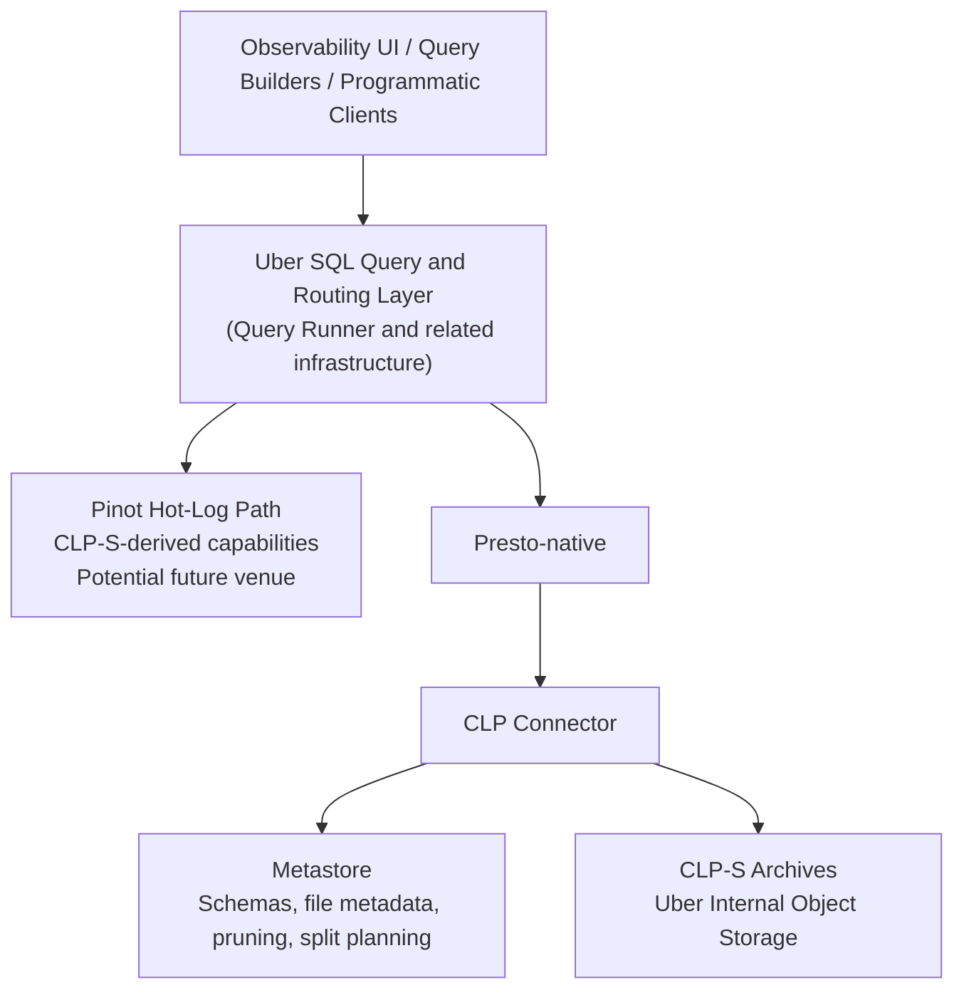

# CLP Part III: Knowledge Base

**Working title:** *Modernizing Logging at Uber with CLP (Part III): Fast, Cost-Efficient SQL over Schemaless Logs*  
**Document status:** Detailed source-of-truth and peer-editing cache  
**Prepared:** August 6, 2026  
**Intended publication:** Uber Engineering Blog  

> This document intentionally contains more detail than the final blog should contain. It captures the agreed narrative, technical design, attribution, production figures, scope boundaries, source links, and remaining verification work. The final article should remain concise; deeper Presto, Pinot, and CLP-S implementation details may be shared through future venues without promising a specific article or channel.

---

## 1. Executive Summary

- CLP began at Uber as a way to compress and retain message-oriented Spark logs economically.
- Uber and YScope subsequently expanded CLP across major platform families:
  - ML/AI platforms, including Michelangelo and Ray
  - Streaming platforms, including Flink and Kafka
  - Traditional data platforms, including Spark and Hudi
- The current deployment processes approximately **25 PB of raw logs per month**.
- After CLP compression, the monthly volume fluctuates between approximately **750 and 850 TB**:
  - Approximately **29–33× compression**
  - Approximately **97% reduction in stored volume**
- Uber and YScope developed language-specific logging appenders that migrate existing message-oriented logs with essentially no application-level changes:
  - Preserve existing natural-language messages
  - Reuse existing pattern-string configurations
  - Automatically convert configured pattern components into JSON fields
  - Add correlation IDs, platform IDs, host IDs, and other operational context
- These appenders blur the conventional boundary between structured and unstructured logs:
  - Message-oriented logs gain a structured JSON envelope.
  - Native JSON events may still contain unstructured natural-language descriptions.
  - JSON syntax does not imply a stable schema.
- CLP supports this full spectrum:
  - Original CLP for unstructured/message-oriented text logs
  - μSlope/CLP-S for semi-structured and native JSON logs
- Part III focuses on integrating CLP-S into Uber's existing SQL-centric query stack through Presto-native.
- The connector provides two complementary capabilities:
  - **Schemaless access is unlocked at the SQL layer.** Users can project and search dynamic fields without predefining every schema or parsing opaque JSON at runtime.
  - **Filtering is pushed down into the compressed-data layer.** Supported operations execute directly against CLP-S's queryable compressed representation.
- The connector also integrates with a metastore abstraction for schema discovery, split enumeration, coarse-grained pruning, and planning-time early termination.
- Uber's production query cluster is small relative to the workload:
  - Five Presto-native workers
  - 48 CPU cores per worker, 240 worker cores total
  - Typical worker CPU utilization of approximately 5–10%
  - Uber deliberately uses API rate limits on its internal object-storage service to pace queries at the lowest practical resource consumption that still keeps the user experience responsive
  - The design target is sufficient UX latency with minimal consumption of shared infrastructure, not maximum query throughput
  - Worker compute, available network throughput, CLP-S decoding, and SQL execution are not the present limits; additional capacity or CPU optimization would not materially improve the current user experience
- The latest metastore implementation can manage metadata for billions of files with approximately:
  - 2–4 CPU cores
  - 32 GB RAM
  - 1 TB disk
- The core connector and enabling Presto-native infrastructure are open source. Uber's production deployment includes additional private metadata, planning, and optimization components; selected components are candidates for future open-source release.

### Central thesis

> CLP makes schemaless logs natural to query in SQL, fast to search, and inexpensive to retain.

### Strong supporting formulations

- **Logs are not simply structured or unstructured; they exist on a spectrum, and CLP supports that full spectrum.**
- **Schemaless at ingestion, schema-aware at query time.**
- **Schemaless access is unlocked at the SQL layer, while filtering is pushed down into the compressed-data layer.**
- **Presto parallelizes the work; the metastore prevents unnecessary work.**
- **Pruning reduces the width of the search; planning-time early termination reduces its depth.**
- **Petabyte-scale log analytics does not require petabyte-scale query compute.**
- **CLP compresses logs into queryable structures, not opaque bytes.**

---

## 2. Recommended Final-Blog Structure

The final post should contain no more than five main sections and one principal architecture diagram.

1. **Background and Motivation**
   - Brief chronology of Parts I and II
   - Expansion across platform families
   - Full spectrum of logs
   - Uber–YScope appender and enrichment work
2. **Architecture and the SQL Integration Gap**
   - Uber's existing SQL query ecosystem
   - Pinot hot path as context only
   - Presto-native + CLP-S warm/cold path
   - Why predefined schemas and opaque JSON both fail
3. **Bringing Native Analytics for Schemaless Logs to Presto**
   - Dynamic projection, filtering, identifiers, and polymorphism
   - Query-language extensions and plan rewriting
   - Metastore pruning and planning-time early termination
   - Brief Presto-native/open-source callout
4. **Production Impact**
   - Compression and storage reduction
   - Five-worker query footprint and CPU utilization
   - Lightweight billion-file metastore
   - One representative pruning/early-termination example if available
5. **Conclusion and What Comes Next**
   - Recap the full-spectrum and SQL-native story
   - Open-source availability
   - Tease separate hot-tier, Presto-native, and CLP-S internals posts

### Suggested content balance

- Background and full-spectrum story: 20–25%
- Architecture and gap: 15–20%
- Technical integration: 35–40%
- Production impact: 15–20%
- Conclusion/open source/future work: 5–10%

---

## 3. Background and Motivation

### 3.1 Chronology of the CLP series

- Link rather than repeat the previous posts:
  - [Part I: Reducing Logging Cost by Two Orders of Magnitude Using CLP](https://www.uber.com/en-GB/blog/reducing-logging-cost-by-two-orders-of-magnitude-using-clp/)
    - Initial Spark integration
    - Streaming compression in the logging path
    - Economical retention
  - [Part II: Modernizing Logging at Uber with CLP](https://www.uber.com/en-GB/blog/modernizing-logging-with-clp-ii/)
    - End-to-end ingestion
    - Search and log viewing
    - Programmatic analytics
- Do not repeat the SSD-burnout history or detailed Part I implementation unless a single sentence is needed for continuity.
- Keep the chronology to approximately two or three sentences in the final blog.

### 3.2 Expansion across Uber platforms

- CLP expanded beyond its original Spark deployment to major platform families:
  - ML/AI: Michelangelo, Ray
  - Streaming: Flink, Kafka
  - Traditional data platforms: Spark, Hudi
- The currently onboarded deployment handles approximately 25 PB of raw logs per month.
- Do **not** claim that thousands of services have already been onboarded.
- Scaling the architecture and onboarding model toward thousands of services is future work.
- If Uber's total service count is mentioned, distinguish it clearly from current CLP adoption.

### 3.3 Uber–YScope language-specific logging appenders

- Uber and YScope developed the appenders together.
- The appenders support low-friction migration of existing message-oriented logs:
  - Preserve existing natural-language messages.
  - Reuse existing logging pattern-string configurations.
  - Automatically convert pattern components into JSON fields.
  - Add common operational context:
    - Correlation IDs
    - Platform-level identifiers
    - Host-level identifiers
    - Other routing, debugging, and operational metadata
  - Require essentially no changes to application logging statements.
  - Require essentially no changes to existing pattern configurations.
- Key adoption point:
  - Applications do not need to redesign how they log in order to gain structured context.
  - Existing unstructured messages can be migrated transparently into enriched JSON events.

### 3.4 The full spectrum of logs

#### Message-oriented logs

- Meaning primarily lives in natural-language text containing embedded variable values.
- Example concept: `Request 123 failed after 250 ms`.
- Original CLP is designed to identify repeated static message structure and encode variable values efficiently.
- Research reference: [CLP: Efficient and Scalable Search on Compressed Text Logs, OSDI '21](https://www.usenix.org/conference/osdi21/presentation/rodrigues).

#### Enriched JSON logs

- The original application message is preserved.
- A structured JSON envelope adds operational context.
- Pattern-string components become addressable fields.
- These logs combine structured metadata with natural-language content.

#### Native JSON event logs

- Meaning primarily lives in fields describing requests, states, inputs, and outcomes.
- Natural-language text may still appear as a `message`, `description`, or similar field.
- Native JSON logs remain dynamically structured:
  - Fields appear and disappear.
  - Nested objects change.
  - Types vary.
- Research reference: [μSlope: High Compression and Fast Search on Semi-Structured Logs, OSDI '24](https://www.usenix.org/conference/osdi24/presentation/wang-rui).
- μSlope was jointly published by researchers and engineers from:
  - YScope
  - University of Toronto
  - Uber Observability
  - Uber Pinot
  - Uber Storage and Search
- This attribution should appear in the article when the paper is introduced; do not characterize μSlope as solely a YScope or university project.

#### Why the boundary is blurred

- A text log can be wrapped in a structured JSON envelope.
- A native JSON log can contain unstructured message fields.
- JSON defines an encoding syntax, not a stable data contract.
- Structured and unstructured should be presented as endpoints on a spectrum, not mutually exclusive categories.

### 3.5 Definitions to introduce for readers

#### Semi-structured logs

- Contain recognizable fields and nested structures.
- Do not conform to one centrally enforced schema across every platform, version, or event.
- Fields may be added, removed, renamed, or nested differently over time.

#### Type polymorphism

- The same field path can hold different types in different events.
- Example:

```json
{"request_id": 12345}
{"request_id": "retry-12345"}
```

- Polymorphism is natural in independently developed systems.
- It conflicts with query engines that expect a stable type for every column at planning time.

### 3.6 Background takeaway and transition

> In collaboration with YScope, Uber developed a logging pipeline that preserves existing messages while transforming them into enriched JSON events. At the same time, CLP supports native JSON event logs. As a result, the practical boundary between structured and unstructured logs has become increasingly blurred.

Transition to the integration problem:

> CLP could compress and search the full spectrum of logs. The next challenge was exposing those heterogeneous, compressed logs through Uber's shared SQL query experience.

---

## 4. Uber Query Architecture

### 4.1 Existing SQL ecosystem

- User and system entry points include:
  - Observability team UI
  - Platform-specific SQL query builders
  - Programmatic SQL clients
- Use Uber's published terminology carefully:
  - **Query Builder**: user platform for executing SQL.
  - **Query Runner**: proxy layer for workload execution.
  - Public reference: [DataCentral: Uber's Observability and Chargeback Platform](https://www.uber.com/en-CA/blog/datacentral-ubers-observability-and-chargeback-platform/).
- Do not assign all routing responsibilities directly to Query Runner without internal verification.
- Safer umbrella term:
  - **Uber's SQL query and routing layer**
  - Query Runner and related infrastructure
- Adjacent published systems provide capabilities such as:
  - Query validation
  - Queuing
  - Routing
  - Cluster selection
  - Failover
- Public Presto-routing context: [Presto Express](https://www.uber.com/blog/presto-express/).

### 4.2 Hot and warm/cold paths

- Pinot serves the hot-log path.
- Presto-native serves warm and cold CLP-S logs.
- Presto is a query engine, not the underlying storage layer.
- CLP-S archives are stored in Uber's internal object-storage service.
- A metastore provides schema and file/archive metadata used during planning.

### 4.3 Suggested architecture diagram



### 4.4 Pinot teaser: context only

- The hot-path implementation is a separate blog-sized topic.
- It should appear only as a brief teaser:
  - Uber and YScope reused both CLP-S ideas and implementation components.
  - They ported and adapted CLP-S dynamic schema discovery and maintenance.
  - They ported and adapted custom tokenization and grep-like search algorithms.
  - These capabilities use Pinot-native structures and Lucene indexes optimized for low-latency random access.
  - Pinot does not store these logs in the native CLP-S archive format.
- Do not include in Part III:
  - Pinot schema-initialization implementation
  - Lucene token layout
  - Key-only/value-only Pinot query mechanics
  - ClickHouse replacement details or compression comparison
- Suggested teaser sentence:

> While this post focuses on querying CLP-S's compressed warm and cold logs through Presto, Uber and YScope also ported and adapted both CLP-S ideas and implementation components—including dynamic schema management, custom tokenization, and grep-like search algorithms—for Pinot's random-access hot tier. The details are outside this post's scope and may be discussed through a future venue.

### 4.5 Data freshness for the Presto/CLP path

- “Warm and cold” describes the storage and access tier; it does not mean users must wait for a log file to close.
- Active log streams are published incrementally.
- Their latest data becomes searchable through Presto before the producing process closes the file.
- Current visibility delay is approximately 30 seconds to a few minutes.
- This freshness is sufficient for current users of the tier; no percentile breakdown will be provided.
- The publication and rotation policy balances three goals:
  - **Compression ratio:** larger chunks generally provide more compression opportunity.
  - **Data freshness:** smaller, more frequent publications reduce event-to-query delay.
  - **Cost:** frequent object-store writes and API requests consume more shared infrastructure.
- The chosen cadence keeps debugging responsive while preserving CLP's compression and cost advantages.

---

## 5. The Integration Gap and Why Presto

### 5.1 Presto's normal table contract

- Presto normally expects columns and their types to be:
  - Predefined
  - Stable
  - Available during query planning
- CLP-S logs violate these assumptions:
  - Fields appear and disappear.
  - Nested structures evolve.
  - Different platforms emit different fields.
  - A field can have multiple types.
  - Keys may not be valid or convenient Presto identifiers.

### 5.2 Why manual schemas do not work

- Require coordination with every platform and producer.
- Require continuous maintenance as logging code changes.
- Delay availability of new fields.
- Create operational burden as the number of datasets grows.
- Still require a policy for polymorphic types.
- Risk dropping, coercing, or hiding unexpected values.

### 5.3 Why one opaque JSON column does not work

- Conventional workaround: store each event as a single JSON string.
- Benefit: avoids defining the complete schema before ingestion.
- Costs:
  - Moves schema interpretation into every query.
  - Requires runtime JSON deserialization.
  - Often parses entire events even when only a few fields are needed.
  - Prevents efficient projection pushdown.
  - Limits predicate pushdown.
  - Increases CPU and memory use.
  - Increases I/O and object-storage transfer.
  - Makes polymorphism the user's problem.
  - Makes key-only and value-only search cumbersome.
- At Uber's volume, this approach is operationally and economically impractical.

### 5.4 Why native schema-oriented SQL is insufficient

Without a predefined schema, standard column-oriented SQL does not naturally express:

- Projection of a field that was never declared as a column.
- Projection of one typed variant of a polymorphic field.
- Key-only search: find events containing a key regardless of its value.
- Value-only search: find a value regardless of which key contains it.
- Key-value search over dynamically discovered fields.
- Search across all typed variants of a field.
- Exact access to keys whose names contain case distinctions or special symbols.

These operations are technically implementable by repeatedly parsing JSON, but not as native, typed, efficient operations over petabyte-scale logs.

### 5.5 Why Presto

- Presto already participates in Uber's SQL query ecosystem.
- Presto already serves warm and cold analytical workloads.
- Presto offers:
  - Distributed execution
  - Familiar SQL
  - Projection
  - Aggregation
  - Grouping
  - Ordering and limits
  - Potential federation with other data sources where applicable
- Its connector architecture allows:
  - CLP-S to remain responsible for compressed storage and scanning.
  - The metastore to remain responsible for schema and file discovery.
  - Presto to remain responsible for SQL planning and distributed relational execution.
- Avoids a separate CLP-specific user workflow.
- Existing UIs, query builders, and programmatic clients can use the integration.

### 5.6 Contribution statement

> YScope engineers, working alongside Uber engineers, developed and productionized a native CLP connector for Presto. The connector exposes dynamically structured CLP-S data through SQL while preserving CLP-S's compression, schema semantics, and query efficiency.

---

## 6. Native SQL Access for Schemaless Logs

### 6.1 Two complementary connector responsibilities

1. **Native schemaless data access**
   - Make dynamic fields addressable from SQL.
   - Map CLP-S types to Presto types.
   - Present schema information during planning.
2. **Log-aware query-language extensions**
   - Express projection and search operations that schema-oriented SQL cannot naturally express over unknown fields.
   - Rewrite supported operations into CLP-S-native execution.

### 6.2 Dynamic schema access

- CLP-S already contains a schema tree representing:
  - Field names
  - Nested relationships
  - Observed value types
  - Polymorphic variants
- The connector uses this information rather than re-discovering the schema by parsing every event.
- Common or stable fields may appear as ordinary Presto columns.
- Dynamic fields can be addressed through typed path-based operations.
- Missing fields return no value/`NULL` semantics rather than invalidating the table.
- Each log event may retain a different structural schema.
- Users can project discovered fields individually.
- When a complete object is requested, it can be returned as a JSON string.
- Current production access does not materialize complete dynamic objects using Presto's `ROW` data type.
- Supporting the `ROW` data type for such objects is a possible future extension.

### 6.3 Projection over dynamic fields

- Users can retrieve:
  - A dynamic primitive field
  - A nested dynamic field
  - A particular typed variant
  - A heterogeneous array through a compatible representation
  - The complete event as JSON when full reconstruction is actually required
- The normal path does not reconstruct the whole event when only one or two fields are requested.
- Projection is therefore both a usability capability and an execution optimization.

### 6.4 Log-aware search semantics

The integration supports or is designed to support operations in the following categories:

- **Key-value search**
  - Match a specific key with a matching value.
- **Key-only search**
  - Match records containing a dynamic key regardless of value.
- **Value-only search**
  - Match a value regardless of the key in which it appears.
- **Typed search**
  - Search only the integer, string, boolean, or other variant of a field.
- **Any-type search**
  - Search across all observed type variants.
- **Wildcard/grep-like search**
  - Preserve log-search expectations rather than generic analyzed-token behavior.

### 6.5 Field-name compatibility

JSON/log keys can contain:

- Case-sensitive distinctions
- Dots
- Hyphens
- Spaces
- `@` and other special characters
- Names that collide with SQL keywords

Problems with direct column mapping:

- Presto identifier rules do not map cleanly to every original JSON key.
- Dots may be interpreted as nested dereferences.
- Normalization can lose distinctions between original keys.
- Quoting every edge case is cumbersome and may not work uniformly for nested fields.

CLP path-based access:

- Preserves the exact original field name.
- Supports case-sensitive lookup.
- Escapes special characters unambiguously.
- Avoids renaming or normalizing source fields during ingestion.

### 6.6 Polymorphism

Example:

```json
{"status": 500}
{"status": "FAILED"}
{"status": true}
```

- CLP preserves each key-and-type combination.
- Users can:
  - Access the integer variant.
  - Access the string variant.
  - Access the boolean variant.
  - Search across all variants.
- This avoids:
  - Converting every value to a string.
  - Discarding unexpected types.
  - Choosing the first observed type and failing later events.
  - Maintaining separate manually defined schemas.

### 6.7 CLP SQL functions/UDFs

- UDFs are the natural SQL representation used to propagate schemaless query mechanics through Presto planning.
- Projection and filtering/search are not always separate UDF categories:
  - The same typed function may appear in `SELECT` to project a field.
  - It may appear in `WHERE` to filter on that field.
  - It may serve both purposes in the same query.
- The [CLP connector RFC](https://github.com/y-scope/presto-rfcs/blob/7ca6b8af915d5f35c5a5ce257e8c548edb0b3c00/RFC-0012-clp-connector.md) proposes illustrative typed functions such as:
  - `CLP_GET_INT(<json-path>)`
  - `CLP_GET_FLOAT(<json-path>)`
  - `CLP_GET_STRING(<json-path>)`
  - `CLP_GET_BOOL(<json-path>)`
- Other proposed operations include:
  - `CLP_GET_JSON_STRING()` for a complete event
  - `CLP_GET_STRING_ARRAY(<json-path>)` for heterogeneous arrays converted to a compatible string-array representation
  - `CLP_WILDCARD_COLUMN()` for searches across any field
- These names represent the RFC design and are not necessarily an exhaustive list of current internal functionality.

Illustrative query:

```sql
SELECT
    CLP_GET_STRING('$.service'),
    count(*)
FROM clp.logs
WHERE
    CLP_GET_INT('$.status') >= 500
    AND CLP_WILDCARD_COLUMN() LIKE '%timeout%'
GROUP BY 1;
```

The example combines:

- Projection of a dynamically discovered field
- A typed predicate
- Value-only search across fields
- Standard SQL aggregation
- The same UDF-based field-access mechanism can drive either projection or filtering.

### 6.8 These are not ordinary record-at-a-time JSON UDFs

- The UDF call is the SQL surface representation, not the intended execution strategy.
- During planning, the connector recognizes supported UDF expressions and rewrites the query.
- The rewritten operations are pushed into CLP-S as native schemaless field access, projection, and filtering.
- The SQL function is the user-facing syntax.
- During planning, the connector:
  - Recognizes the CLP expression.
  - Resolves its path and requested type.
  - Rewrites it into an internal CLP-S column operation.
  - Pushes compatible predicates into the CLP-S scan.
- The worker reads the corresponding compressed structures directly.
- It does not reconstruct and deserialize every JSON record before evaluating the expression.

Memorable formulation:

> The UDF is the SQL syntax; query-plan rewriting is the mechanism; CLP-S performs the execution.

### 6.9 Pushdown correctness

- Push down only operations that CLP-S can evaluate safely.
- Supported classes may include:
  - Boolean `AND`, `OR`, and `NOT`
  - Numeric comparisons
  - Equality and inequality
  - Wildcard string expressions
  - Nested field references
- Unsupported expressions remain in Presto.
- Pushed-down execution must return a superset of the correct result whenever only part of a predicate tree can be pushed down.
- Example correctness rule:
  - Do not push one side of an `OR` if doing so would remove rows needed by the other side.

### 6.10 User and system outcome

Users do not need to:

- Predefine every field.
- Maintain schemas continuously.
- Know which archives contain a field.
- Parse full JSON documents.
- Enumerate every possible column for value-only search.
- Coerce every polymorphic value to a string.

The system gains:

- Projection pushdown
- Predicate pushdown
- Less decoding
- Less materialization
- Less object-storage transfer
- Lower CPU and memory requirements

Primary formulation:

> CLP does not make schemaless logs look relational by repeatedly parsing JSON. It searches the encoded representation as compressed bytes arrive, uses its schema tree, dictionaries, and statistics to identify candidate regions, and selectively decodes or decompresses only the regions likely to contain matches. Raw JSON/text is not reconstructed and scanned in full.

---

## 7. CLP-S Execution over Object Storage

### 7.1 Native execution path

- CLP-S's reader and query implementation are written in C++.
- Presto-native workers call the CLP-S reader directly.
- Requested values are materialized into native Presto/Velox vectors.
- Avoids a per-record Java-to-native bridge.
- Keeps compressed scanning close to the native query engine.

### 7.2 Object-storage-oriented streaming search

- CLP-S archives are independently searchable units.
- Workers stream archive data from Uber's internal object-storage service.
- Search begins as bytes arrive.
- Complete archives do not need to be downloaded and staged before searching.
- Production workers do not stage archives on local data disks.
- The production query path does not rely on a local archive/data cache.
- Search operates directly against the CLP-S objects stored in object storage.
- CLP-S searches the encoded representation rather than first decompressing the archive into raw JSON/text and scanning it.
- The schema tree, log-type dictionaries, and statistics identify encoded regions that could contain matches.
- Only candidate regions are selectively decoded or decompressed.
- Matching events and requested fields are materialized after this narrowing step.
- CLP-S is optimized for high-throughput sequential scanning of its compressed representation.
- High compression reduces the number of bytes transferred from object storage.
- Projection and predicate pushdown reduce the amount of data decoded and returned to Presto.

### 7.3 Performance and cost framing

- Avoid saying only that the experience "feels native."
- The intended claim is both usability and execution efficiency:
  - Native SQL access
- Make the two-stage performance model explicit:
  - Metadata pruning and early termination avoid unnecessary work before execution.
  - CLP-S searches the remaining encoded data quickly and selectively decodes candidate regions.
  - The production footprint depends on both work avoidance and fast native execution.
- Preferred CLP-S execution metric, if available:
  - Compressed GB/s per worker, per core, or aggregate after planning
  - Clearly state the denominator and whether object-storage API pacing is included
  - CLP-native compressed execution
  - Object-storage economics
  - Low compute cost
- Defensible formulation:

> CLP provides a native SQL experience without paying the storage and runtime costs of repeatedly parsing schemaless JSON. Its object-storage-optimized format delivers high query performance with a small compute footprint.

---

## 8. Metastore-Guided Query Planning

### 8.1 Why the metastore matters

- Presto provides distributed execution.
- At petabyte scale, distributed execution alone is insufficient.
- The system must avoid:
  - Listing billions of objects for every query.
  - Creating unnecessary splits.
  - Opening irrelevant archives.
  - Streaming unneeded compressed data.
- Strong formulation:

> Presto parallelizes the work; the metastore prevents unnecessary work.

### 8.2 No hard dependency on one metastore

- The connector is metastore-agnostic.
- It relies on abstractions/providers for:
  - Table and schema metadata
  - File/archive discovery
  - Split generation
  - Coarse-grained filter translation
- Open-source deployments can use a provided implementation.
- Uber connects the abstractions to its internal metadata infrastructure.

### 8.3 Useful/required metastore properties

- Manage metadata for a very large number of files or archives.
- Support top-level indexed fields that can be added or removed.
- Filter efficiently on those fields.
- Support time-range and other range-based pruning.
- Maintain evolving schema and type information.
- Handle continuous ingestion and retention/deletion updates.
- Return ordered metadata lazily or through a streaming cursor.
- Allow early cursor cancellation.
- Transactions are helpful but not a hard dependency.
- Eventual consistency is acceptable if the surrounding ingestion/query workflow maintains correctness.

### 8.4 Uber's latest metastore implementation

- Can manage metadata for billions of files.
- Top-level indexed fields can evolve.
- Approximate resource footprint:
  - 2–4 CPU cores
  - 32 GB RAM
  - 1 TB disk
- The latest MySQL/MariaDB implementation uses ordered, streaming metadata queries.
- These figures describe one implementation, not connector requirements.

### 8.5 What belongs in the metastore

At a high level, metadata may include:

- File or archive location
- Minimum timestamp
- Maximum timestamp
- Record count
- File-level dimensions such as platform, service, host, path, or other routing identifiers
- Precomputed counts/statistics for common filters
- Schema and field-type information
- Lifecycle/retention state

The metastore should not attempt to become a full token/event index.

> The metastore indexes just enough information to avoid unnecessary scans; it does not index the logs themselves.

---

## 9. Metadata Pruning

### 9.1 Definition

- Predicate-driven.
- Removes files that cannot contain matching events.
- Does not require `ORDER BY` or `LIMIT`.
- Can use:
  - Time ranges
  - File-level dimensions
  - Precomputed aggregate counts
  - Other indexed top-level fields

### 9.2 Question pruning answers

> Could this file contain any matching event?

### 9.3 Execution

- Extract supported top-level filters from the SQL plan.
- Translate them into a metastore query.
- Return a correctness-preserving superset of files required by the full predicate.
- Generate Presto splits only for the surviving files/archives.
- Apply remaining event-level filters inside CLP-S or Presto as appropriate.

### 9.4 Independent but composable

- Pruning is logically independent of planning-time early termination, but the two optimizations compose in one query.
- It can be used:
  - Alone
  - Together with early termination
  - With queries that have no ordering or limit
- Combined query shape:

```sql
WHERE application_id = 'app-123' AND host = 'host-456'
ORDER BY timestamp DESC
LIMIT 100
```

- Top-level filters prune the candidate archives first.
- Early termination then processes only the surviving metadata in timestamp order and stops when older candidates cannot change the filtered Top-N result.

---

## 10. Planning-Time Early Termination

### 10.1 Problem with standard Presto execution

- Presto does not guarantee split execution order.
- A normal query is planned and scheduled to completion.
- Presto generally cannot stop simply because enough apparently ordered data has arrived.
- For a standard `ORDER BY timestamp LIMIT` query, a generic plan may:
  - Generate every qualifying split.
  - Scan every qualifying file.
  - Perform global Top-N.
  - Discard almost all matching rows.

### 10.2 Log-specific physical properties

- Logs are append-only.
- Events within each compressed file are sorted by timestamp.
- The total dataset is a collection of immutable, time-sorted chunks rather than one globally sorted file.
- The metastore knows each file's timestamp bounds.
- The metastore may contain exact per-file counts for supported predicates.
- Log queries have strong temporal locality:
  - Recent logs are queried more frequently.
  - Users commonly ask for the earliest/latest matching events.
  - Queries commonly contain a time range.

### 10.3 Eligible query shape

```sql
SELECT ...
FROM logs
WHERE ...
ORDER BY timestamp DESC
LIMIT 100;
```

Eligibility/prerequisites:

- A supported `LIMIT`
- Ordering by the recognized log timestamp
- No incompatible aggregation
- Known minimum and maximum timestamp per file
- Sufficient matching-count metadata for supported filters, or another correctness-preserving bound
- Required invariants maintained during ingestion

Not eligible:

- No `LIMIT`
- Ordering by a non-timestamp field
- Aggregation such as `COUNT(*)`
- Query shapes where omitted files cannot be proven irrelevant to the result

Ineligible queries fall back to ordinary split generation and a complete scan of the pruned set.

### 10.4 Where the optimization occurs

Simplified Presto lifecycle:

1. Parse SQL.
2. Analyze tables and columns.
3. Optimize and push down predicates.
4. **Split manager performs planning-time early termination.**
5. Scheduler distributes the selected splits.
6. Workers scan files.

The optimization does **not** require Presto to execute splits in timestamp order.

### 10.5 High-level descending-order algorithm

1. Apply predicate-based pruning.
2. Query/stream remaining metadata ordered by each file's maximum timestamp descending.
3. Accumulate matching-event counts from candidate files.
4. Track a watermark based on the minimum timestamp of selected files.
5. Once the cumulative count can satisfy `LIMIT`, establish a cutoff timestamp.
6. Continue including files whose time ranges overlap the cutoff.
7. Stop consuming metadata once the next file's maximum timestamp is older than the cutoff.
8. Close the streaming metadata cursor.
9. Generate splits only for the selected correctness-preserving subset.
10. Let Presto execute those splits in any order and apply normal global Top-N.

### 10.6 Why overlapping files matter

- Files are individually sorted but their timestamp ranges can overlap.
- Selecting only the first files whose counts exceed `LIMIT` may be incorrect.
- Any file overlapping the timestamp watermark could still contain an event belonging in global Top-N.
- The algorithm includes overlapping files and stops only after the remaining time ranges cannot affect the answer.

### 10.7 Streaming metadata query

Conceptual metadata query:

```sql
SELECT ...
FROM file_metadata
WHERE <time and top-level filters>
ORDER BY max_timestamp DESC;
```

- A non-streaming implementation would:
  - Transfer all matching metadata rows.
  - Materialize the complete file list.
  - Discard much of it after computing Top-N eligibility.
- A streaming implementation:
  - Applies filters and ordering in the metadata database.
  - Returns rows through a cursor.
  - Lets the split manager consume files incrementally.
  - Closes the cursor once the cutoff proves remaining files cannot matter.
- Benefits:
  - Fewer metadata rows transferred
  - Lower planning memory
  - Lower planning latency
  - Fewer splits generated
  - Fewer object-storage reads

### 10.8 Pruning versus early termination

#### Pruning

- Predicate-driven.
- Eliminates files with no possible match.
- Answers: **Could this file contain any matching event?**

#### Early termination

- Ordering-and-limit-driven.
- Eliminates files that may match but cannot change the ordered, limited result.
- Answers: **Could this file still affect global Top-N?**

#### Combined execution

1. Select time-based metadata partitions where applicable.
2. Apply top-level predicate pruning.
3. Stream surviving metadata in timestamp order.
4. Accumulate counts and calculate the watermark.
5. Stop split discovery when remaining files cannot affect Top-N.
6. Execute only the final split set.

Strong formulation:

> We did not change Presto's scheduler to guarantee split order or add general runtime short-circuiting. Instead, we used log-specific metadata to prove during split planning which files could contain the global Top-N result.

The underlying early-termination design material is internal working material and must not be linked or cited in the public article.

---

## 11. Presto-Native Plugin Infrastructure

### 11.1 Technical gap

- CLP-S's reader is native C++ code.
- Presto-native is the C++ worker implementation built on Velox.
- Before this work, Presto-native did not fully support independently developed, out-of-band connectors implemented entirely in C++.
- Existing plugin behavior was largely represented by test infrastructure.
- Needed capabilities included:
  - Dynamic loading of a connector outside the core repository
  - Factory registration without compiling the connector into the engine
  - Connector-specific binary serialization/deserialization routing
  - Exchange of connector-specific handles between the Java coordinator and native workers

### 11.2 Result

- CLP became the first non-test/reference implementation of an out-of-band Presto-native connector implemented fully in C++.
- This validated the plugin architecture in a production use case.
- The reusable infrastructure can support future native connectors beyond CLP.

### 11.3 Relevant upstream work

- [Presto PR #27653: Hoist plugin loading and de-inline factory map for dynamic connector support](https://github.com/prestodb/presto/pull/27653)
- [Presto PR #27652: Add customSerializedValue routing for binary connector deserialization](https://github.com/prestodb/presto/pull/27652)

### 11.4 Attribution

- **YScope engineers**
  - Primary contributors to the CLP connector and much of the enabling work.
  - ChenXing Yang, Jack Luo, and others contributed to the referenced upstream changes.
  - Worked alongside Uber engineers throughout development and production integration.
- **Uber engineers**
  - Worked directly with YScope on requirements, integration, validation, and productionization.
- **IBM contributors**
  - Provided infrastructure-level development, including portions of Presto-native plugin loading.
  - Deepak Majeti provided substantial review.
  - Tim, the Presto chair, helped drive the work from the Presto side.
- **Meta contributors**
  - Provided feedback and technical discussion.
- **Presto Foundation**
  - Drove/coordinated the upstream effort on the Presto side, primarily through IBM and Meta contributors.

### 11.5 Editorial scope

- In Part III, keep this to one short subsection or callout.
- Save for a possible deeper Presto treatment in a future venue:
  - Dynamic library loading details
  - Factory maps
  - Coordinator-to-worker serialized connector handles
  - `customSerializedValue` routing
  - Packaging and deployment mechanics
  - Native versus Java execution comparison

---

## 12. Open-Source Availability

### 12.1 Public connector

- [YScope CLP Presto connector](https://github.com/y-scope/clp-plugin-presto-connector)
  - Public implementation of the connector/plugin.
  - Reference implementation of the Presto-native extension model.

### 12.2 Main CLP integration

- [Main YScope CLP repository](https://github.com/y-scope/clp)
  - Integrates Presto as a CLP query-engine option.
  - Allows users to:
    - Ingest/compress JSON logs with CLP-S.
    - Expose each CLP dataset as a Presto table.
    - Query nested fields with SQL.
    - Run queries from the CLP UI or Presto CLI.
- Public guide: [Using Presto with CLP](https://docs.yscope.com/clp/v0.12.0/user-docs/guides-using-presto.html).

### 12.3 Public versus production functionality

- The open-source integration provides an end-to-end reference deployment.
- Uber and YScope maintain additional private production components with more advanced:
  - Metastore integration
  - Split discovery
  - Query planning
  - Optimization
  - CLP-S-aware advanced search capabilities
- Selected internal components are planned for future open-source release.
- Do not imply that internal functionality is already present in the public connector.

### 12.4 Use beyond Uber

- The CLP–Presto integration is also used by YScope partners.
- Partner deployments operate at double-digit-petabyte monthly log volumes.
- Phrase as partners, not customers.
- Before publication, determine whether the cited volume describes:
  - At least one partner
  - Multiple individual partner deployments
  - Aggregate partner volume

---

## 13. Production Impact

### 13.1 Scale and compression

- Raw monthly input: approximately **25 PB**.
- Compressed monthly output: approximately **750–850 TB**.
- Implied compression ratio: approximately **29–33×**.
- Stored-volume reduction: approximately **97%**.
- Compressed volume fluctuates with the workload and log mix.
- This workload supports the earlier rough 32× average; label the measurement period in the final article.
- Keep the Spark-specific 169× figure from Part I separate from the current multi-platform deployment.

Suggested wording:

> Uber ingests approximately 25 PB of raw logs per month into CLP, compressing them to roughly 750–850 TB—a 29–33× reduction depending on workload mix.

### 13.2 Query cluster

- Five Presto-native workers.
- 48 CPU cores per worker.
- 240 worker cores total.
- Serves Uber's production CLP query workload for the onboarded platforms.
- Typical worker CPU utilization: approximately 5–10%.
- Workers are not heavily loaded and retain substantial compute headroom.
- The team has not felt a need to add capacity or prioritize further CPU-performance optimization.

### 13.3 Object-storage governance and streaming behavior

- Workers stream CLP-S archives from Uber's internal object-storage service.
- Search proceeds as the data arrives.
- There is no local-disk staging and no archive/data cache in the production query path.
- Query throughput is deliberately paced using an object-storage API rate limit.
- Uber applies this limit so the CLP workload consumes the smallest practical share of an internal service used by many workloads while still meeting the user-experience objective.
- This is a resource-governance choice, not a physical compute or network-throughput bottleneck.
- CLP-S decoding and SQL execution are not the CPU bottleneck.
- Adding CPU alone would not materially improve the current workload.
- Queries are already fast enough to keep the current user experience responsive. Additional speed is intentionally traded for lower shared-resource consumption.
- Metastore pruning and early termination reduce object-storage requests and retrieved data before streaming begins.

Suggested combined wording:

> Uber serves queries over approximately 25 PB of raw logs ingested per month using five 48-core Presto-native workers. Workers stream and search CLP-S archives directly from Uber's internal object storage, without local-disk staging or an archive cache. CPU utilization typically remains between 5% and 10%, while query latency remains fast enough for a responsive user experience. Uber deliberately paces the workload using object-storage API rate limits so that it consumes the smallest practical share of this common infrastructure while satisfying users' latency expectations. The design target is not maximum throughput, and additional worker capacity or CPU optimization would not materially improve the current experience.

### 13.4 Metastore footprint

- Handles metadata for billions of files.
- Approximately 2–4 CPU cores.
- 32 GB RAM.
- Approximately 1 TB disk.
- Supports dynamic addition/removal of top-level indexed fields.
- Demonstrates that the metadata plane does not need to become a second large infrastructure system.

### 13.5 Only additional statistic worth prioritizing

Find one representative production query demonstrating both planning optimizations:

- Files before pruning
- Files after pruning
- Files/splits after planning-time early termination
- Compressed physical gigabytes read from object storage
- Object-storage API requests with and without the optimizations
- End-to-end latency

Ideal narrative form:

> A representative latest-event query began with X million files. Top-level pruning reduced the candidate set to Y files, and planning-time early termination generated only Z splits. The query read N GB of compressed physical data, reduced object-storage API requests from A to B, and completed in T seconds.

- Prefer API request count over transferred bytes because request-rate governance is the relevant shared-service constraint.
- Also include compressed gigabytes read because the small physical volume demonstrates the combined value of compression and work elimination.
- Clearly distinguish compressed physical bytes from the logical raw log volume represented by the archives.
- Gather all values from one consistently defined production query; otherwise remove unsupported comparisons.

Do not turn the article into an operational dashboard. Query counts, WAU, QPS, availability, and cost-per-query are optional unless an individual figure is exceptionally compelling and directly supports the narrative.

---

## 14. CLP-S Structures and Future Capabilities

### 14.1 CLP-S retains log-native structure

- Dynamic schema tree:
  - Field names
  - Nesting
  - Observed types
  - Polymorphic variants
- Logtype dictionaries:
  - Repeated message templates
  - Separation of static text and variable values
  - Pattern frequency
  - Representative event structure
- File/archive statistics:
  - Timestamp bounds
  - Record counts
  - Common filter counts
  - Planning/pruning information

### 14.2 Higher-level capabilities

- Automatic log summaries:
  - Common log patterns
  - New or unusual patterns
  - Error-pattern distributions
  - Representative messages
- Schema-change detection
- Pattern-frequency analysis
- Anomaly detection
- Cross-service correlation
- AI-assisted incident investigation
- Efficient semantic search

### 14.3 Semantic-search direction

- Internal work leverages CLP-S internals to support semantic search over petabyte-scale archives.
- Potential efficiency mechanism:
  - Operate on deduplicated logtypes/templates and retained schema context rather than every duplicated raw message.
  - Map matching templates back to underlying events.
  - Avoid a full-size semantic index over every log line.
- Directional claims:
  - CPU-only execution
  - Very low query cost
  - Components planned for future open source
- Do not publish "petabyte-scale semantic search for pennies without GPUs" until the following are defined:
  - Pennies per query, TB, PB, or another denominator
  - Logical data searched
  - Physical bytes scanned
  - Query latency
  - CPU resources
  - Workload and comparison baseline

Safer future-work wording:

> We are also developing CLP-S-aware optimizations for CPU-only semantic search over petabyte-scale log archives. Early internal results show that these searches can be performed at very low cost, and we plan to open-source selected components in the future.

### 14.4 Scope boundary

- Part III should mention these capabilities only as a short forward-looking implication.

### 14.5 Possible local/edge execution

- Directly searchable CLP-S archives do not inherently require centralized Presto execution.
- For suitable future use cases, compute could move closer to the user:
  - An engineer's laptop could stream and search authorized CLP-S archives directly from object storage.
  - Another managed edge environment could perform the same role.
- Potential benefit:
  - Avoid consuming centralized query-cluster resources for suitable investigations.
  - Preserve the same compressed, streaming search model.
- This is an architectural possibility, not a product commitment.
- Any implementation would require appropriate access control, credential handling, API-rate governance, and limits on local resource use.
- Detailed algorithms are outside this article's scope and may be discussed through a future venue.

---

## 15. Recommended Conclusion

### Recap bullets

- Logs exist on a spectrum from message-oriented text to native JSON events.
- Uber and YScope made it possible to enrich existing logs without rewriting application logging code.
- CLP supports the complete spectrum.
- The Presto connector makes dynamic CLP-S fields usable through SQL.
- Query-language extensions support projection and search over fields not present in a predefined schema.
- Plan rewriting pushes supported operations into CLP-S's compressed scan.
- A pluggable metastore performs coarse pruning and supports scalable split planning.
- Planning-time early termination exploits append-only, time-sorted log files for common ordered-limit queries.
- CLP-S streams searchable compressed archives directly from object storage.
- The resulting production footprint is small relative to the 25 PB/month raw workload.

### Recommended conclusion statement

> CLP does more than expose compressed logs to SQL. It makes schemaless data practical to project, search, and analyze while preserving the performance and cost advantages of a log-native compressed representation.

### Optional future-work mentions

- **Pinot hot tier**
  - Both CLP-S ideas and implementation components
  - Ported and adapted schema discovery and maintenance
  - Ported and adapted custom tokenization and grep-like search algorithms
  - Pinot/Lucene structures optimized for random access
- **Potential deeper Presto treatment**
  - Out-of-band Presto-native plugin infrastructure
  - C++ connector loading
  - Coordinator/native-worker serialization
  - Upstream Presto work
- **Potential deeper CLP-S treatment**
  - CLP-S schema-tree internals
  - Encoded storage layout
  - Logtype dictionaries
  - Summaries and semantic search
- **Possible local/edge execution**
  - Search authorized CLP-S archives from an engineer's laptop or another edge environment
  - Avoid requiring every suitable investigation to run through centralized Presto workers
  - Treat as a direction, not a roadmap promise
- **Longer-term Uber work**
  - Scale onboarding toward thousands of services

---

## 16. Explicit Scope Exclusions for Part III

Do not include unless the story changes materially:

- Detailed Pinot/Lucene implementation
- Detailed ClickHouse replacement comparison
- Deep CLP-S compression-format internals
- Encoded record-table internals
- Presto-native dynamic-loading implementation details
- Factory-map and serialization code walkthroughs
- Full Metalog/MySQL/MariaDB implementation design
- Long lists of UDFs
- Top-N pseudocode or formal proof
- Unmeasured semantic-search claims
- Broad KQL criticism
- The crossed-out SSD-database history from the original rough outline
- Large operational dashboards of loosely relevant statistics

---

## 17. Editorial Guidance and Terminology

### Use

- CLP-S
- Schemaless logs / dynamically structured logs
- Semi-structured logs, with a short definition
- Type polymorphism, with an example
- Presto-native
- Query Runner, when referring to the published Uber component name
- Uber's SQL query and routing layer, when referring to the broader system
- YScope partners, not customers
- Metastore-agnostic connector
- Planning-time early termination
- Metadata pruning

### Avoid or qualify

- "SQL cannot support semi-structured data."
  - Too broad.
  - Better: Presto's schema-oriented table contract expects predefined, stable fields and types.
- "These operations are impossible without CLP."
  - Too absolute.
  - Better: They are impractical to provide as native, typed, efficient SQL operations at Uber scale without a specialized layer such as CLP.
- "Presto is storage."
  - Incorrect; it is the query engine over CLP-S/object storage.
- "Query Runner performs all parsing, routing, and failover."
  - Responsibilities span related infrastructure; verify before assigning them to one component.
- "Velox plugin."
  - Incorrect terminology for this work.
  - Use **Presto-native plugin**.
- "First production Velox plugin."
  - Incorrect.
  - Use **first non-test/out-of-band Presto-native connector/plugin**, subject to final wording verification.
- "Meta, IBM, and Uber jointly built the connector."
  - Incorrect collaboration structure.
  - YScope engineers were primary connector contributors working alongside Uber engineers; IBM contributed infrastructure/review; Meta provided feedback; Presto Foundation drove upstream coordination.
- "32× across every workload."
  - Label the current multi-platform range as 29–33× and keep Spark's 169× historical figure separate.

---

## 18. Remaining Verification and Data Requests

### Metrics

- Measurement window for:
  - 25 PB/month raw input
  - 750–850 TB/month compressed output
  - 5–10% worker CPU
- Confirm whether CPU figure is average, typical range, or another statistic.
- One representative pruning + early-termination query:
  - Before/after file counts
  - Bytes transferred
  - Latency

### Architecture

- Final public name for Uber's internal object-storage service, if it may be named.
- Whether to name the production metastore or keep it generic.
- Exact division of responsibilities among Query Runner and related services.
- Confirm whether the final architecture diagram should show ingestion as well as query flow.

### Query-language implementation

- Exact UDF/function names currently available in:
  - Public connector
  - Uber private production connector
- Exact behavior of:
  - Key-only search
  - Value-only search
  - Any-type polymorphic access
  - Case-sensitive/special-character field paths
- Which operations are pushed down today versus planned.

### Early termination

- Confirm production eligibility constraints.
- Confirm maximum supported limit, if publishable.
- Confirm which filters have exact per-file matching counts.
- Confirm handling of unsupported content filters.
- Confirm whether time partitioning is currently deployed or a later iteration.

### Attribution

- Full name/title for Tim if included.
- Confirm publishable contribution language for:
  - ChenXing Yang
  - Jack Luo
  - Deepak Majeti
  - IBM
  - Meta
  - Presto Foundation
- Decide whether detailed acknowledgments belong in the main post or only the acknowledgments section.

### User impact

- Optional real incident or failure-diagnosis example.
- Expand any internal acronym such as "MCP" before publication.
- Identify whether cross-source joins are a real production use case or merely enabled by Presto.

### Draft publication checklist

- Confirm the reporting window and whether scale figures should be exact values or rounded ranges.
- Confirm that approximately 30 seconds to a few minutes is the approved public freshness range; no percentile breakdown is expected.
- Confirm that the five-worker claim is scoped to Uber's current warm and cold CLP query workload.
- Fill every benchmark placeholder from one consistently defined production query, or remove the unsupported row.
- Measure encoded CLP-S throughput after planning and state whether it is per worker, per core, or aggregate.
- Prefer object-storage API request count for the shared-service constraint, while separately reporting compressed physical bytes read.
- Verify the deployed and public UDF names before publication; examples based only on the connector RFC must be updated.
- Confirm approved wording for QueryRunner and the platform names that may be disclosed.
- Confirm whether partner scale and local or edge execution may be mentioned.
- Replace text diagrams with publication-quality illustrations.

---

## 19. Source and Reference Index

### Prior Uber CLP posts

- [Reducing Logging Cost by Two Orders of Magnitude Using CLP](https://www.uber.com/en-GB/blog/reducing-logging-cost-by-two-orders-of-magnitude-using-clp/)
- [Modernizing Logging at Uber with CLP (Part II)](https://www.uber.com/en-GB/blog/modernizing-logging-with-clp-ii/)

### Research

- [CLP: Efficient and Scalable Search on Compressed Text Logs, OSDI '21](https://www.usenix.org/conference/osdi21/presentation/rodrigues)
- [μSlope: High Compression and Fast Search on Semi-Structured Logs, OSDI '24](https://www.usenix.org/conference/osdi24/presentation/wang-rui) — jointly published by YScope, the University of Toronto, and Uber's Observability, Pinot, and Storage and Search teams

### Connector design and implementation

- [CLP Connector RFC](https://github.com/y-scope/presto-rfcs/blob/7ca6b8af915d5f35c5a5ce257e8c548edb0b3c00/RFC-0012-clp-connector.md)
- [Open-source CLP Presto connector](https://github.com/y-scope/clp-plugin-presto-connector)
- [Main CLP repository](https://github.com/y-scope/clp)
- [Using Presto with CLP](https://docs.yscope.com/clp/v0.12.0/user-docs/guides-using-presto.html)
- [CLP Connector Documentation](https://docs.yscope.com/presto/connector/clp.html)

### Presto-native infrastructure

- [Presto PR #27653: Dynamic connector support](https://github.com/prestodb/presto/pull/27653)
- [Presto PR #27652: Binary connector deserialization routing](https://github.com/prestodb/presto/pull/27652)

### Metastore and early termination

- Internal early-termination design material exists but is not a public publication reference and must not be linked or cited.

### Uber query ecosystem

- [DataCentral: Uber's Observability and Chargeback Platform](https://www.uber.com/en-CA/blog/datacentral-ubers-observability-and-chargeback-platform/)
- [Presto Express](https://www.uber.com/blog/presto-express/)
- [Preon: Presto Query Analysis for Intelligent and Efficient Analytics](https://www.uber.com/en-DE/blog/preon/)
- [Engineering SQL Support on Apache Pinot at Uber](https://www.uber.com/en-GB/blog/engineering-sql-support-on-apache-pinot/)
- [Serving Millions of Apache Pinot Queries with Neutrino](https://www.uber.com/en-US/blog/serving-millions-of-apache-pinot-queries-with-neutrino/)

---

## 20. One-Paragraph Working Abstract

Uber and YScope expanded CLP from its original Spark deployment to major ML/AI, streaming, and data platforms that collectively generate approximately 25 PB of raw logs per month. These logs span natural-language messages, enriched JSON events, and native JSON records with evolving schemas and polymorphic types. To integrate this data with Uber's SQL-centric query ecosystem, YScope engineers working alongside Uber engineers developed a Presto-native CLP connector that unlocks projection and log-specific search over schemaless data while pushing supported filters into CLP-S's compressed scan. A pluggable metastore prunes irrelevant files and performs planning-time early termination for ordered log queries. In production, CLP compresses the monthly raw volume to approximately 750–850 TB, while five lightly utilized Presto-native workers serve the query workload by streaming and searching archives directly from object storage, without local-disk staging or an archive cache.
